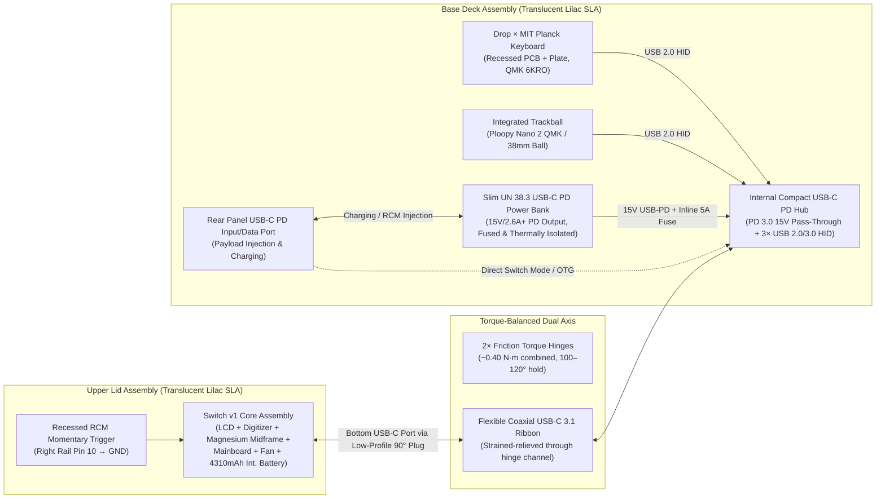

# Nintendo Switch v1 (Erista) → Clamshell Cyberdeck (`ns-conv`)

A complete, reversible hardware conversion that transforms an unpatched first-generation **Nintendo Switch v1 (2017 Erista, `HAC-001`)** into a **translucent lilac clamshell cyberdeck** integrating a **Drop × OLKB MIT Planck 40% ortholinear keyboard**, a **compact USB HID trackball**, and an **internal slim UN 38.3 USB-C PD power bank**.

---

## System Architecture Overview



### Core Design Principles

1. **Zero-Destruction Reversibility:** The Switch's factory-bonded LCD, capacitive digitizer, die-cast magnesium midframe, thermal heatpipe/fan, and internal 4310 mAh battery remain intact as a single structural module inside the upper lid. No PCB traces are cut, and the risky LCD/digitizer adhesive separation is completely avoided.
2. **No High-Speed MIPI DSI Extension Across the Hinge:** Prior art shows that passively extending the Switch's 53-pin MIPI DSI LCD ribbon across a hinge causes severe signal reflection and black-screen failures. Keeping the mainboard and display together in the lid means **only a single USB-C cable** crosses the hinge into the base.
3. **Horizon OS Safety First:** Stock `sysNAND` remains 100% unmodified for online play. Custom firmware (**Kefir AIO**) and Linux (**Switchroot L4T Ubuntu 24.04 Noble**) run strictly from a high-endurance microSD card (`emuNAND` + Linux ext4 partition) with `exosphere`/`dns.mitm` telemetry blanking.
4. **Translucent Lilac Industrial 3D Printing:** All enclosure components are designed in parametric OpenSCAD (`cad/`) for **SLA Translucent Resin with custom Pantone Lilac dyeing** and clear UV-protective urethane coating via **PCBWay (`UTR-8100 Transparent`)** or **JLC3DP (`8001 Translucent`)**.

---

## Build Phase Status & Deliverables

This project is executed strictly phase-by-phase with user sign-off between phases:

| Phase | Deliverable | Document / Path | GitHub Issue | Status |
| :--- | :--- | :--- | :--- | :--- |
| **1** | **Research Summary** (Prior art, hardware verification, OS HID behavior, trackball & battery trade-offs) | [`docs/research.md`](docs/research.md) | [#1](https://github.com/JonasNowak/ns-conv/issues/1) | **Complete** |
| **2** | **Bill of Materials (BOM)** (Every part, tool, consumable, EUR pricing, suppliers & alternatives) | [`docs/bom.md`](docs/bom.md) & [`hardware/BOM.csv`](hardware/BOM.csv) | [#2](https://github.com/JonasNowak/ns-conv/issues/2) | **Complete** |
| **3** | **Teardown Plan** (Step-by-step Switch v1 & Drop Planck non-destructive disassembly) | [`docs/teardown.md`](docs/teardown.md) | [#3](https://github.com/JonasNowak/ns-conv/issues/3) | **Complete** |
| **4** | **Electronics & Wiring Plan** (USB-C hub vs harness, PD power-bank topology, fusing, thermals) | [`docs/wiring.md`](docs/wiring.md) & [`hardware/`](hardware/) | [#4](https://github.com/JonasNowak/ns-conv/issues/4) | **In Review (Phase 4 Complete)** |
| **5** | **Parametric OpenSCAD CAD Package** (`config.scad`, lid, base, hinge brackets, jigs, STLs) | `cad/` | [#5](https://github.com/JonasNowak/ns-conv/issues/5) | Pending User Go-Ahead |
| **6** | **3D Print Order Specification** (PCBWay / JLC3DP translucent lilac order spec & test-fit jigs) | `docs/print-spec.md` | [#6](https://github.com/JonasNowak/ns-conv/issues/6) | Pending |
| **7** | **Assembly Guide** (Step-by-step mechanical & electrical build, torque sequence, first boot) | `docs/assembly.md` | [#7](https://github.com/JonasNowak/ns-conv/issues/7) | Pending |
| **8** | **Software Setup Guide (Deferred — User-Owned)** (Live links & hardware constraints placeholder) | [`docs/software.md`](docs/software.md) & [`software/README.md`](software/README.md) | [#8](https://github.com/JonasNowak/ns-conv/issues/8) | **Placeholder Active (Deferred)** |
| **9** | **Test & Acceptance Checklist** (Horizon OS, L4T Linux, USB HID, PD charging, thermals, hinges) | `docs/testing.md` | [#9](https://github.com/JonasNowak/ns-conv/issues/9) | Pending |
| **10** | **Risk Register** (Top 10 technical, safety, and ban risks with mitigations) | `docs/risks.md` | [#10](https://github.com/JonasNowak/ns-conv/issues/10) | Pending |

---

## Repository Structure

```text
ns-conv/
├── README.md                 # Project overview, architecture, and build phase tracker
├── docs/
│   ├── research.md           # Phase 1: Prior art, donor verification & subsystem trade-offs
│   ├── bom.md                # Phase 2: Bill of Materials & EUR budget (upcoming)
│   ├── teardown.md           # Phase 3: Non-destructive Switch v1 & Planck teardown (upcoming)
│   ├── wiring.md             # Phase 4: Internal USB-C hub, PD power bank & fusing plan (upcoming)
│   ├── print-spec.md         # Phase 6: PCBWay / JLC3DP translucent lilac print spec (upcoming)
│   ├── assembly.md           # Phase 7: Mechanical assembly & first power-on guide (upcoming)
│   ├── software.md           # Phase 8: Deferred software placeholder & hardware constraints
│   ├── testing.md            # Phase 9: Test & acceptance checklist (upcoming)
│   └── risks.md              # Phase 10: Top 10 risk register (upcoming)
├── cad/                      # Phase 5: Parametric OpenSCAD sources, Makefile & STL exports
├── hardware/                 # BOM.csv, wiring schematics, and component datasheet references
└── software/                 # User-owned Kefir CFW & Switchroot L4T Ubuntu notes/scripts
```
