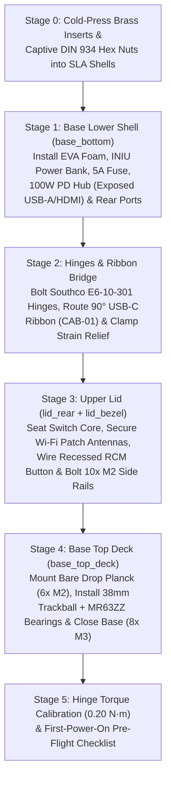

# Phase 7: Step-by-Step Mechanical & Electrical Assembly Guide (`docs/assembly.md`)

This guide covers the complete mechanical and electrical assembly of the **`ns-conv`** Nintendo Switch v1 clamshell cyberdeck into your premade SLA enclosure.

> [!IMPORTANT]
> **Pre-Requisite Before Starting Assembly:**
> 1. Complete your donor Switch v1 and Drop × MIT Planck preparation per [`docs/teardown.md`](teardown.md).
> 2. Verify all 5 interfaces on [`cad/stl/test_fit_jig.stl`](../cad/stl/test_fit_jig.stl) per [`docs/print-spec.md`](print-spec.md).
> 3. Ensure the Switch's internal battery is switched **OFF** and the **INIU 45W Slim Power Bank (`PWR-01`)** is switched **OFF** (`ELC-02` toggle open) throughout mechanical assembly.

---

## 1. Assembly Workflow Overview

---

## 2. Stage 0: Fastener & Insert Preparation in Thermoset SLA Resin

> [!CAUTION]
> **NEVER Use a Hot Soldering Iron on SLA Photopolymer Resin (`UTR-8100` / `8001` / `9000R`):**
> Unlike FDM thermoplastics (PLA/PETG/ABS), SLA resin is a cross-linked **thermoset**. Heating it with a `250 °C` soldering iron will char and crack the boss rather than melt it. All blind brass inserts (`MEC-03`) are sized in [`cad/config.scad`](../cad/config.scad) (`Ø3.15 mm` for `M2`, `Ø4.45 mm` for `M3`) for **room-temperature press-fit + medium cyanoacrylate (CA) gel bonding (`TOL-02`)**.

### 2.1 Blind Knurled Brass Inserts (`MEC-03`) Installation Map

Apply a micro-drop of medium CA gel (`TOL-02`) to the outer knurls of each insert (keep adhesive out of the internal threads!) and press it flush at room temperature using the flat face of an `M2`/`M3` screw and washer:

| Printed Part | Insert Size (`MEC-03`) | Qty | Exact Locations |
| :--- | :--- | :-: | :--- |
| **[`base_bottom.stl`](../cad/stl/base_bottom.stl)** | `M3 × 4 × 4.5 mm` | `8×` | Top faces of the 8 perimeter standoff pillars (`base_boss_pts`) that hold `base_top_deck`. |
| **[`base_bottom.stl`](../cad/stl/base_bottom.stl)** | `M2 × 3 × 3.2 mm` | `2×` | Rear center spine (`X = ±14 mm, Y = 146 mm`) for the lower [`cable_clamp.stl`](../cad/stl/cable_clamp.stl). |
| **[`base_top_deck.stl`](../cad/stl/base_top_deck.stl)** | `M2 × 3 × 3.2 mm` | `6×` | Underside of the 6 Planck mounting bosses (`X = 21.5, 116.5, 211.5 mm`; `Y = 21.5, 59.5 mm`). |
| **[`base_top_deck.stl`](../cad/stl/base_top_deck.stl)** | `M2 × 3 × 3.2 mm` | `2×` | Underside of the trackball optical sensor PCB cradle (`X = +106 ± 12 mm`). |
| **[`lid_rear.stl`](../cad/stl/lid_rear.stl)** | `M2.5 / M2 × 3 × 3.2 mm` | `6×` | Top faces of the 6 perimeter bezel bosses (`bezel_boss_pts`) that hold `lid_bezel`. |
| **[`lid_rear.stl`](../cad/stl/lid_rear.stl)** | `M2 × 3 × 3.2 mm` | `2×` | Inner hinge exit tunnel (`X = ±14 mm, Y = 14 mm`) for the upper [`cable_clamp.stl`](../cad/stl/cable_clamp.stl). |

*Let the CA gel cure for **15 minutes** before threading any screws into the inserts.*

### 2.2 Captive Stainless Hex Nuts (`DIN 934`, `MEC-02`) Installation Map

Press the following stainless steel `DIN 934` hex nuts into their hexagonal counterbores (secured with a tiny dot of CA gel on the outer hex flat if desired):
- **[`base_bottom.stl`](../cad/stl/base_bottom.stl) underside:**
  - `2× M3 DIN 934` hex nuts under the power bank retainer bosses (`X = -80 mm`, `Y = 15.5 mm` and `Y = 93.5 mm`).
  - `4× M3 DIN 934` hex nuts under the left and right hinge mounting pads (`X = -95 ± 12.7 mm` and `X = +95 ± 12.7 mm`, `Y = 153.5 mm`).
- **[`lid_rear.stl`](../cad/stl/lid_rear.stl) outer rear face:**
  - `4× M3 DIN 934` hex nuts in the rear hinge leaf pockets (`X = -95 ± 12.7 mm` and `X = +95 ± 12.7 mm`, `Y = 8.5 mm`).

---

## 3. Stage 1: Base Lower Shell (`base_bottom`) — Power, Hub & Exposed Ports

### 3.1 Exposed External USB, HDMI & Charging Ports Map

Before installing the internal components into [`base_bottom.stl`](../cad/stl/base_bottom.stl), review how the external I/O ports are exposed through the base walls:

| Exposed Port Location on `base_bottom` | Exposed Connector | Function in Horizon OS & L4T Linux |
| :--- | :--- | :--- |
| **Right-Side Flush I/O Window** (`X = +153 mm, Y = 108..131 mm`) | **`1× USB-A 3.0 (5 Gbps)`** + **`1× 4K HDMI`** *(directly on `HUB-01`)* | Plug in external USB flash drives, USB Ethernet, SDR dongles, controllers, or an external HDMI monitor without opening the deck. |
| **Rear Panel Left** (`X = -42 mm, Y = 162 mm`) | **`1× Panel-Mount USB-C PD Socket (`CAB-03`)`** | Plug in your external `15V / 2.6A–3A` USB-C PD wall charger to charge both the INIU power bank and the Switch simultaneously. |
| **Rear Panel Center Pocket** (`X = 0 mm, Y = 150..162 mm`) | **Recessed `CAB-01` USB-C Coupler** | Normal operation: plugged into `HUB-01` upstream lead. RCM payload injection: unplug `HUB-01` here to connect `CAB-01` directly to your PC/RCM loader. |
| **Rear Panel Right** (`X = +42 mm, Y = 162 mm`) | **Master Power Cutoff Switch (`ELC-02`)** | Physically disconnects the power bank `VBUS` output during storage/transport so zero parasitic current is drawn by the hub. |

### 3.2 Step-by-Step Base Wiring & Component Mounting

1. **Install Rear Panel-Mount USB-C Socket (`CAB-03`) & Power Switch (`ELC-02`):**
   - Feed the `CAB-03` USB-C female nose into the rear-left cutout (`X = -42 mm`) and fasten its ears with `2× M2 × 8 mm` screws + `M2` nuts (`0.15 N·m`).
   - Snap the `ELC-02` rocker/toggle switch into the rear-right rectangular window (`X = +42 mm`).
2. **Seat the 5-in-1 100W USB-C PD Hub (`HUB-01`) Against the Right-Side Cutout Window:**
   - Place a strip of `1.5 mm` EVA foam (`MEC-04`) on the floor of the rear-right hub cradle (`X = +22..137 mm, Y = 105..133 mm`).
   - Press `HUB-01` (`UGREEN Revodok 105` / `Baseus 5-in-1`) into the cradle with its **end-cap `USB-A 3.0` and `4K HDMI` ports facing right (`+X`)**, flush with the right-side cutout window on [`base_bottom.stl`](../cad/stl/base_bottom.stl#L207-L209).
   - Verify that a standard USB-A thumb drive and HDMI plug insert cleanly from the outside right edge of the case.
3. **Mount the INIU 45W Slim Power Bank (`PWR-01`) & Inline `5A` Blade Fuse (`ELC-01`):**
   - Adhere two `100 × 20 × 1.5 mm` strips of high-density EVA foam (`MEC-04`) onto the floor of the front-left battery bay (`X = -135..-25 mm, Y = 20..88 mm`), keeping the 8 bottom intake louver slots unobstructed.
   - Lay the **INIU `P50-E1` 45W Slim Power Bank** into the bay with its USB-C ports facing right (`+X`) toward the center wiring channel.
   - Place [`battery_retainer.stl`](../cad/stl/battery_retainer.stl) across the top of the power bank (with a `1.5 mm` EVA foam strip on the underside of the strap) and fasten with **`2× M3 × 22 mm` screws** into the external bosses (`0.35 N·m`).
   - **Safety Verification:** Visually confirm that both `M3` screws sit completely outside the battery bay perimeter ribs (`≥4.5 mm` lateral clearance from the pouch cell casing).
   - Connect the **Inline `5A` Fast-Acting Blade Fuse (`ELC-01`)** and **`ELC-02` Cutoff Switch** in series between the power bank's `15V PD` output and the `100W PD IN` port of `HUB-01` per [`docs/wiring.md`](wiring.md).

---

## 4. Stage 2: Torque Hinges (`MEC-01`) & Hinge USB-C Ribbon Routing (`CAB-01`)

1. **Bolt the Southco `E6-10-301-20` / `CL226` Hinges to the Base:**
   - Seat the lower leaf of each friction hinge into the left (`X = -95 mm`) and right (`X = +95 mm`) rear spine pockets of [`base_bottom.stl`](../cad/stl/base_bottom.stl).
   - Apply one drop of blue **Medium Threadlocker `243` (`TOL-02`)** to **`4× M3 × 12 mm` socket-head screws** (with `M3` flat washers under the heads) and thread them down into the captive `M3` hex nuts on the underside of `base_bottom`. Tighten to **`0.50 N·m`**.
2. **Route the 90° Flat Flexible USB-C Ribbon (`CAB-01`) Through the Center Hinge Tunnel:**
   - Feed the female coupler end of the `20 cm` 90° flat FPC USB-C cable (`CAB-01`) from the upper lid cavity down through the `22 × 6 mm` center tunnel between the two hinges into the rear coupler pocket of `base_bottom`.
   - Leave a gentle **`15 mm` S-curve service loop** at the hinge pivot axis (`Y = 154 mm, Z = 24.5 mm`) so the `0.5 mm`-thick FPC ribbon rolls smoothly without tension over the full `0°` (closed) to `125°` (open) travel.
   - Fasten the lower [`cable_clamp.stl`](../cad/stl/cable_clamp.stl) over the ribbon inside `base_bottom` using **`2× M2 × 6 mm` screws** (`0.15 N·m`).
3. **Bolt the Upper Lid Shell (`lid_rear`) to the Upper Hinge Leaves:**
   - Align the upper hinge leaves into the rear pockets of [`lid_rear.stl`](../cad/stl/lid_rear.stl) (`X = ±95 mm, Y = 8.5 mm`).
   - Apply blue Threadlocker `243` to **`4× M3 × 10 mm` button-head screws** and fasten into the captive `M3` hex nuts (`0.50 N·m`).
   - Fasten the upper [`cable_clamp.stl`](../cad/stl/cable_clamp.stl) over the ribbon inside `lid_rear` with **`2× M2 × 6 mm` screws** (`0.15 N·m`).

---

## 5. Stage 3: Upper Lid Assembly (`lid_rear` + `lid_bezel`) — Switch Core, Wi-Fi Antennas & RCM Button

### 5.1 How Wi-Fi & Bluetooth Work Inside the Lid (Zero Signal Loss)

The Switch v1 mainboard uses a **Broadcom/Cypress `BCM4356` 2×2 MIMO 802.11ac (2.4 GHz / 5 GHz) + Bluetooth 4.1** radio connected to two flat **PCB patch antennas** via white and black micro-coaxial (`U.FL`) cables:
- Because [`lid_rear.stl`](../cad/stl/lid_rear.stl) and [`lid_bezel.stl`](../cad/stl/lid_bezel.stl) are printed in **non-conductive SLA photopolymer resin (`2.5 mm` wall)** with zero metallic fillers, the lid is **100% RF-transparent**—matching the RF attenuation of Nintendo's original ABS backplate.
- During assembly, keep both `U.FL` coaxial connectors snapped onto the mainboard and secure the two flat PCB patch antennas into the non-metallic upper-left and lower-right bays of `lid_rear` using a strip of double-sided tape or Kapton tape (ensuring neither antenna is tucked *underneath* the magnesium midframe or copper EMI shield).

### 5.2 Step-by-Step Switch Core & Lid Bezel Installation

1. **Install the Recessed RCM Momentary Button (`RCM-01`) on the Right Lid Wing:**
   - Solder or clip two `10 cm` `30 AWG` wires from your spare Right Joy-Con rail / RCM jig (`DON-03`: **Pin 10 `HOME/RCM`** and **Pin 1 `GND`**) to the terminals of the `6 × 6 × 5 mm` tactile switch (`RCM-01`).
   - Seat `RCM-01` into the right-wing pinhole pocket of [`lid_rear.stl`](../cad/stl/lid_rear.stl) (`X = +118 mm, Y = 28 mm`) with a dot of CA gel on the switch body corners, and slide the Joy-Con flex connector onto the Switch's right-hand rail header.
2. **Connect `CAB-01` and Seat the Switch v1 Core (`DON-01`):**
   - Plug the 90° right-angle male USB-C plug of `CAB-01` into the Switch's bottom USB-C port (`X = 0, Y = 30 mm`).
   - Lower the Switch core (`166.5 × 102.0 × 11.8 mm`) into the centered cradle of [`lid_rear.stl`](../cad/stl/lid_rear.stl), verifying that:
     - The rear cooling intake grille (`X = -15..+25 mm, Y = 55..85 mm`) aligns over the rear louvers.
     - The top Power button, Volume `+/-` buttons, `3.5 mm` audio jack, Game Card slot, and top heatsink exhaust align with the top-edge cutouts (`Y = 162 mm`).
     - The microSDXC slot aligns with the bottom-left access cutout (`X = -52 mm`).
   - Reconnect the Switch's internal `4310 mAh` battery `BM05` connector onto the mainboard (`docs/teardown.md` Step 2.3).
3. **Bolt the Switch Core via the 10× Side-Rail `M2` Screws (Crisscross Torque Sequence):**
   - Thread **`10× M2 × 8 mm` stainless screws (`MEC-02`)** through the left and right internal side-wall flanges of [`lid_rear.stl`](../cad/stl/lid_rear.stl) directly into the 10 factory `M2` tapped holes on the Switch's die-cast magnesium midframe (`Y = 12.0, 31.5, 51.0, 70.5, 90.0 mm`).
   - Tighten in a **center-outward star sequence** to **`0.18 N·m`** (snug finger-tight; do not over-torque `M2` threads in magnesium):
     1. Left `Y = 51.0 mm` → 2. Right `Y = 51.0 mm`
     3. Left `Y = 31.5 mm` → 4. Right `Y = 70.5 mm`
     5. Right `Y = 31.5 mm` → 6. Left `Y = 70.5 mm`
     7. Left `Y = 12.0 mm` → 8. Right `Y = 90.0 mm`
     9. Right `Y = 12.0 mm` → 10. Left `Y = 90.0 mm`
4. **Fasten the Front Screen Bezel (`lid_bezel`):**
   - Place [`lid_bezel.stl`](../cad/stl/lid_bezel.stl) over the Switch core so the `1.6 mm` inner lip gently frames the outer black border of the touch digitizer without pinching the active `137.4 × 77.6 mm` LCD area.
   - Fasten with **`6× M2.5 × 8 mm` (or `M2 × 8 mm`) button-head screws** around the perimeter (`bezel_boss_pts`) to **`0.20 N·m`**.
   - Press `4× Ø6 × 1.5 mm` silicone lid bumpers (`MEC-04`) into the four corner recesses on the front face of `lid_bezel`.

---

## 6. Stage 4: Base Top Deck (`base_top_deck`) — Planck Keyboard & 38 mm Trackball

1. **Mount the Bare Drop × MIT Planck Keyboard (`DON-02`):**
   - Plug one `15 cm` flat silicone USB-A to USB-C cable (`CAB-02`) into the Planck's rear-left USB-C port (`X = -104.5 mm`).
   - Lower the bare Planck switch-plate + PCB assembly (`233.0 × 81.0 mm`) into the recessed left pocket of [`base_top_deck.stl`](../cad/stl/base_top_deck.stl).
   - From the underside (or through the switch plate standoffs), thread **`6× M2 × 6 mm` screws** into the 6 Planck bosses in a **center-outward order** (`X = 116.5 mm` center pair first, then `X = 21.5 mm` left pair and `X = 211.5 mm` right pair) to **`0.15 N·m`**.
2. **Install the 38 mm Trackball (`PER-01`):**
   - Slide the three **`MR63ZZ (3 × 6 × 2.5 mm)` roller bearings** onto their `3 × 10 mm` stainless dowel pins and snap them into the three `120°`-spaced slots inside the spherical trackball socket (`X = +106 mm, Y = 62 mm`) of [`base_top_deck.stl`](../cad/stl/base_top_deck.stl). Spin each bearing with your fingertip to confirm free rotation.
   - Bolt the `PMW3360` + `RP2040` optical sensor PCB beneath the `Ø8.0 mm` bottom lens aperture using **`2× M2 × 5 mm` screws** (`0.12 N·m`), verifying the sensor lens sits `2.4 mm` below the bottom surface of the `38 mm` ball.
   - Plug the second `15 cm` USB-A to USB-C cable (`CAB-02`) into the trackball MCU.
3. **Connect Downstream USB Cables & Close the Base Enclosure:**
   - Lower `base_top_deck` above `base_bottom` and plug both `CAB-02` USB-A plugs (Planck + Trackball) into the two internal USB-A ports of `HUB-01`.
   - Plug the `HUB-01` upstream USB-C pigtail into the `CAB-01` female coupler inside the rear center pocket.
   - Seat `base_top_deck` onto the `1.5 mm` alignment lip of `base_bottom` and fasten with **`8× M3 × 10 mm` button-head screws** in a center-outward crisscross pattern to **`0.30 N·m`**.
   - Drop the `38.0 mm` trackball into the right-hand socket and press `4× Ø10 × 3 mm` self-adhesive silicone feet (`MEC-04`) into the bottom corner recesses of `base_bottom`.

---

## 7. Stage 5: Hinge Torque Calibration & First-Power-On Pre-Flight Checklist

### 7.1 Hinge Torque Calibration (`0.20 N·m` per Hinge)
1. Open the lid to **`112°`**.
2. Using the **`H1.5` hex key (`TOL-01`)**, turn the radial friction adjustment set-screw on the barrel of the left and right **Southco `E6-10-301-20` / `CL226`** hinges in equal **`1/8`-turn increments** clockwise until:
   - The lid holds any angle between **`90°` and `125°`** without drooping when you tap the touchscreen, and
   - Opening the lid slowly requires smooth, even resistance (`~0.40 N·m` combined across both hinges).
3. Close the lid to **`0°`** and verify that the `38 mm` trackball nests cleanly inside the spherical parking pocket in the right wing of `lid_bezel` while the 4 silicone lid bumpers rest evenly on the palm rest.

### 7.2 Fastener Torque Summary Table

| Fastener Location | Screw Spec (`MEC-02`) | Target Torque | Thread Treatment |
| :--- | :--- | :---: | :--- |
| **Hinge Leaves → `base_bottom` & `lid_rear`** | `8× M3 × 10–12 mm` + `DIN 934` Nut | **`0.50 N·m`** | Blue Threadlocker `243` (`TOL-02`) |
| **Power Bank Retainer → `base_bottom`** | `2× M3 × 22 mm` + `DIN 934` Nut | **`0.35 N·m`** | Dry (nylon washer optional) |
| **`base_top_deck` → `base_bottom` (8× Bosses)** | `8× M3 × 10 mm` into Brass Inserts | **`0.30 N·m`** | Dry |
| **`lid_bezel` → `lid_rear` (6× Bosses)** | `6× M2.5/M2 × 8 mm` into Brass Inserts | **`0.20 N·m`** | Dry |
| **Switch Magnesium Midframe → `lid_rear` (10×)** | `10× M2 × 8 mm` into Switch Midframe | **`0.18 N·m`** | Dry (Star sequence) |
| **Planck Plate (`6×`), Clamps (`4×`) & Rear USB-C (`2×`)** | `12× M2 × 6–8 mm` into Brass Inserts | **`0.15 N·m`** | Dry |
| **Trackball Sensor PCB → `base_top_deck` (`2×`)** | `2× M2 × 5 mm` into Brass Inserts | **`0.12 N·m`** | Dry |

### 7.3 First-Power-On Pre-Flight Checklist

Before pressing the Switch Power button or flipping `ELC-02` ON:
- [ ] **1. Short-Circuit / Continuity Check:** With `ELC-02` **OFF**, use a multimeter across the rear `CAB-03` USB-C `VBUS` and `GND` pins (or verify the `5A` blade fuse `ELC-01` is intact and unblown).
- [ ] **2. Battery Screw Clearance Check:** Confirm both `M3 × 22 mm` retainer screws sit outside the INIU power bank ribs with `1.5 mm` EVA foam above and below the bank.
- [ ] **3. Standalone Switch Boot Check (`ELC-02` OFF):** Press the top-edge **Switch Power Button** for 3 seconds. Verify the Switch LCD illuminates, touchscreen responds, fan spins quietly, and Wi-Fi detects local networks.
- [ ] **4. Internal Hub + Power Bank Activation (`ELC-02` ON):** Flip the rear **`ELC-02` Power Switch ON**. Verify:
  - The Switch top-right battery icon displays the **lightning bolt charging indicator** (`15V USB-C PD` active).
  - The **Drop × MIT Planck** RGB/LEDs initialize and typing works in the Horizon OS text keyboard (`6KRO` mode) and L4T Ubuntu Linux.
  - Rolling the **38 mm Trackball** moves the cursor smoothly in L4T Ubuntu Linux (and Hekate NYX).
- [ ] **5. Recessed RCM Button Check:** Power the Switch completely **OFF**, unplug `HUB-01` inside the rear center pocket to connect `CAB-01` to your PC/RCM dongle, hold the recessed **RCM button (`RCM-01`) + Volume `+`**, and verify `TegraRcmGUI` / `fusee-nano` detects `APX / RCM OK`.
