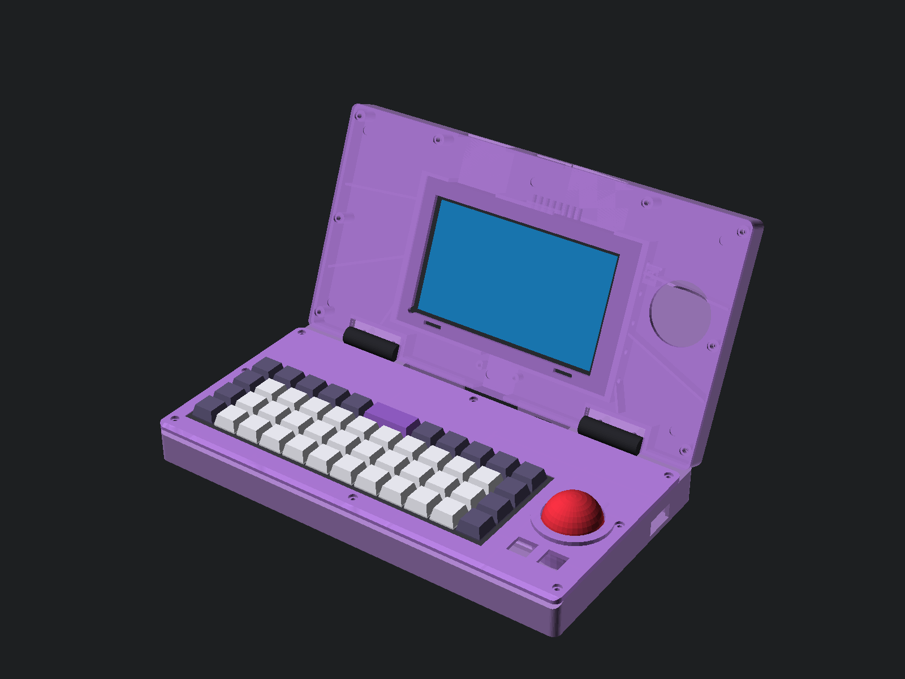
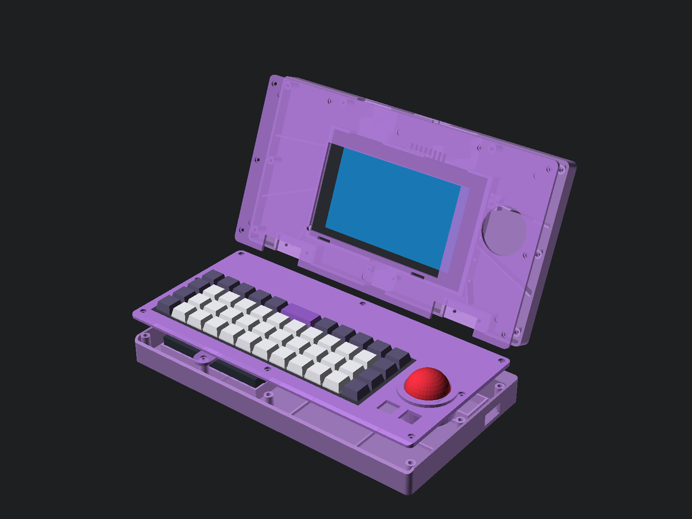
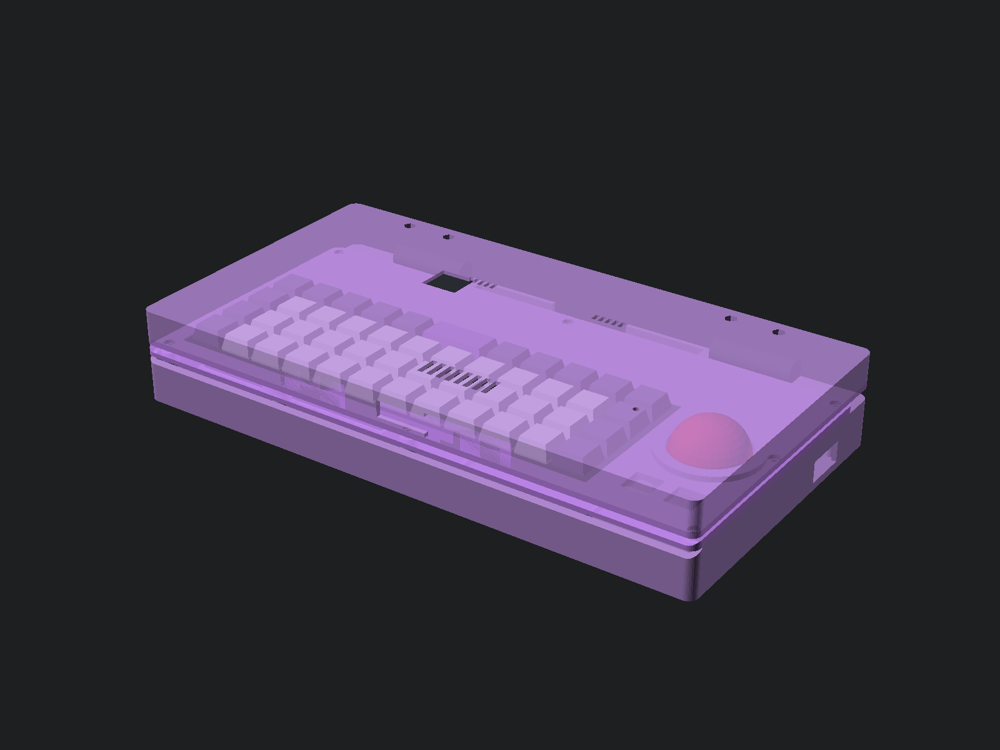

# Phase 5: Parametric OpenSCAD CAD Package & Dimensioned Overview (`docs/cad-overview.md`)

All custom enclosure components for the `ns-conv` clamshell cyberdeck are authored as modular, parametric OpenSCAD source files in [`cad/`](../cad/) driven by a single shared configuration file ([`cad/config.scad`](../cad/config.scad)). Every part has been compiled and validated as a watertight **2-manifold mesh** (`Status: NoError`) using **OpenSCAD 2026 Manifold** into both [`.stl`](../cad/stl/) and [`.3mf`](../cad/3mf/) formats.

---

## 1. Visual Renders of the Current Design

### 1.1 Open Clamshell Isometric View (`112°` Typing Angle)


### 1.2 Exploded Assembly View (Showing Internal Power Bank, Retainer & Switch Core)


### 1.3 Closed Clamshell View (`0°` — Showing 38 mm Trackball Nested in Right Lid Wing)


---

## 2. Dimensioned Orthographic Overview Drawing (Units: `mm`)

```text
================================================================================
  TOP VIEW — BASE TOP DECK (cad/base_top_deck.scad + cad/base_bottom.scad)
  All dimensions in millimeters (mm). Origin (0,0) = Center-X, Front Edge Y=0.
================================================================================

  |<------------------------------ 306.00 mm (deck_w) ----------------------------->|
  +---------------------------------------------------------------------------------+ --- Y = 162.00 mm (Rear Edge)
  |  [==== Southco Hinge (-96.0) ====]   [CAB-01]   [==== Southco Hinge (+96.0) ====] |     (16.0mm Hinge Spine)
  |---------------------------------------------------------------------------------| --- Y = 146.00 mm
  |  (o) M3                               (o) M3                                (o) |
  |                                                                                 |
  |       |<------------- 233.00 mm [USER_VERIFY: planck_w] ------------->|         |
  |       +---------------------------------------------------------------+         | --- Y = 97.00 mm
  |       |  (o) (21.5, 59.5)                             (211.5, 59.5) (o)|         |
  |       |                                                               |  /---\  | --- Y = 68.00 mm (tball_cy)
  |       |       DROP x MIT PLANCK REV 6 RECESSED TRAY                   | |38mm | |     (tball_cx = +121.0mm)
  | (o)   |                   (o) (116.5, 40.5)                           | |Ball | |  <- Right-Side USB-A &
  |       |            (2.0mm Perimeter Support Ledge +                   |  \---/  |     4K HDMI Window (HUB-01)
  |       |             2.0mm Solid SLA Battery Barrier Floor)            | [MX][MX]| --- 2x 14x14mm Thumb Clicks
  |       |  (o) (21.5, 21.5)                             (211.5, 21.5) (o)|         |
  |       +---------------------------------------------------------------+         | --- Y = 16.00 mm (planck_y0)
  |  (o) M3                               (o) M3                                (o) |
  +---------------------------------------------------------------------------------+ --- Y = 0.00 mm (Front Wrist Bevel)
  |<10.0>|<-------------------------- 233.00 --------------------------->|<--63.0-->|


================================================================================
  INNER VIEW — UPPER LID SHELL & SWITCH CRADLE (cad/lid_rear.scad + lid_bezel.scad)
================================================================================

  |<------------------------------ 306.00 mm (deck_w) ----------------------------->|
  +---------------------------------------------------------------------------------+ --- Y = 162.00 mm (Top Edge)
  | (o)          [Pwr][Vol+/-]     [=== 42.0mm Exhaust ===] [Audio][GameCard]   (o) |
  |              +---------------------------------------------------------+        | --- Y = 128.00 mm
  |              |o (Y=90.0)                                     (Y=90.0) o|[RCM]   | <-- Recessed 6x6mm RCM
  |              |o (Y=70.5)     NINTENDO SWITCH v1 CORE         (Y=70.5) o|      _ |     Momentary Switch Pocket
  |  \           |o (Y=51.0)    166.50 x 102.00 x 11.80 mm       (Y=51.0) o|    /   \
  |   \ Diagonal |               [USER_VERIFY: sw_core_*]                  |   | Ø41 | <- Trackball Parking
  | (o)\ Ribs    |  [microSD]       (137.0 x 77.2mm LCD)                   |    \ _ /     Dome (Closed Lid)
  |     \        |o (Y=31.5)                                     (Y=31.5) o|        |
  |              |o (Y=12.0)   [Intake Grille]     [Intake Grille](Y=12.0)o|        |
  |              +-----------------------+---------+-----------------------+        | --- Y = 26.00 mm (sw_bottom_y)
  | (o)          [==== Hinge (-96) ====] | CAB-01  | [==== Hinge (+96) ====]    (o) |
  +--------------------------------------+---------+--------------------------------+ --- Y = 0.00 mm (Hinge Edge)
                 |<--- 10x M2 Side-Rail Bolts (5 Left + 5 Right) --->|


================================================================================
  SIDE CROSS-SECTION — CLOSED CLAMSHELL STACKUP (Z-Height = 46.50 mm Total)
================================================================================

  Z = 46.50 mm  +------------------------------------------------------------+  --- Outer Rear Face of Upper Lid
                |  2.50 mm Lid Rear Wall + OEM Fan Intake / Exhaust Louvers  |
                |  11.80 mm Switch v1 Core (Magnesium Midframe + LCD + Glass)|
                |  3.00 mm Lid Front Bezel Retainer (cad/lid_bezel.scad)     |
  Z = 28.50 mm  +================== [1.5mm Silicone Bumpers] ================+  --- Split Line (12.0mm Keycap Gap)
  Z = 24.50 mm  |  4.00 mm Base Top Deck Flange (cad/base_top_deck.scad)     |
                |  10.50 mm Planck Rev 6 PCB & Kailh Hotswap Cavity          |
                |  2.00 mm Solid SLA Battery Isolation Barrier Floor         |
                |  18.50 mm INIU 45W Slim Power Bank + 1.5mm EVA Foam Pad    |
                |  2.50 mm Base Bottom Floor + Intake Ventilation Louvers    |
  Z =  0.00 mm  +------------------------------------------------------------+  --- Desk Surface (+3mm Silicone Feet)
```

---

## 3. Custom Printable Part Inventory & Manifold Mesh Verification

All 7 custom parts compile with `--backend=Manifold --hardwarnings` with **zero non-manifold edges or self-intersections**:

| Part ID | OpenSCAD Source | Exported STL / 3MF | Bounding Box (`X × Y × Z mm`) | Vertices / Facets | Manifold Status | Preview |
| :--- | :--- | :--- | :---: | :---: | :---: | :---: |
| **1. Base Bottom** | [`cad/base_bottom.scad`](../cad/base_bottom.scad) | [`base_bottom.stl`](../cad/stl/base_bottom.stl)<br>[`base_bottom.3mf`](../cad/3mf/base_bottom.3mf) | `306.0 × 162.0 × 24.5` | `8,662 / 17,464` | `NoError` (2-Manifold) | [Render](renders/base_bottom.png) |
| **2. Base Top Deck** | [`cad/base_top_deck.scad`](../cad/base_top_deck.scad) | [`base_top_deck.stl`](../cad/stl/base_top_deck.stl)<br>[`base_top_deck.3mf`](../cad/3mf/base_top_deck.3mf) | `306.0 × 146.0 × 23.5` | `7,325 / 14,730` | `NoError` (2-Manifold) | [Render](renders/base_top_deck.png) |
| **3. Lid Rear Shell** | [`cad/lid_rear.scad`](../cad/lid_rear.scad) | [`lid_rear.stl`](../cad/stl/lid_rear.stl)<br>[`lid_rear.3mf`](../cad/3mf/lid_rear.3mf) | `306.0 × 162.0 × 15.0` | `8,698 / 17,548` | `NoError` (2-Manifold) | [Render](renders/lid_rear.png) |
| **4. Lid Front Bezel** | [`cad/lid_bezel.scad`](../cad/lid_bezel.scad) | [`lid_bezel.stl`](../cad/stl/lid_bezel.stl)<br>[`lid_bezel.3mf`](../cad/3mf/lid_bezel.3mf) | `306.0 × 162.0 × 4.2` | `3,616 / 7,276` | `NoError` (2-Manifold) | [Render](renders/lid_bezel.png) |
| **5. Battery Strap** | [`cad/battery_retainer.scad`](../cad/battery_retainer.scad) | [`battery_retainer.stl`](../cad/stl/battery_retainer.stl)<br>[`battery_retainer.3mf`](../cad/3mf/battery_retainer.3mf) | `18.0 × 96.0 × 5.2` | `764 / 1,544` | `NoError` (2-Manifold) | [Render](renders/battery_retainer.png) |
| **6. USB-C Clamps** | [`cad/cable_clamp.scad`](../cad/cable_clamp.scad) | [`cable_clamp.stl`](../cad/stl/cable_clamp.stl)<br>[`cable_clamp.3mf`](../cad/3mf/cable_clamp.3mf) | `38.0 × 26.0 × 4.5` | `1,465 / 2,938` | `NoError` (2-Manifold) | [Render](renders/cable_clamp.png) |
| **7. Test-Fit Jig** | [`cad/test_fit_jig.scad`](../cad/test_fit_jig.scad) | [`test_fit_jig.stl`](../cad/stl/test_fit_jig.stl)<br>[`test_fit_jig.3mf`](../cad/3mf/test_fit_jig.3mf) | `105.0 × 55.0 × 17.0` | `2,773 / 5,582` | `NoError` (2-Manifold) | [Render](renders/test_fit_jig.png) |

---

## 4. `[USER_VERIFY]` Dimension Table (Check Before Final Print)

Every variable below in [`cad/config.scad`](../cad/config.scad) is marked with `// [USER_VERIFY]`. Measure your disassembled Switch v1 core and Drop × MIT Planck Rev 6 with digital calipers (or test them against `test_fit_jig.stl`):

| Variable in `cad/config.scad` | Default Value | Hardware Feature to Measure | How to Adjust if Different |
| :--- | :---: | :--- | :--- |
| `sw_core_w` | `166.50 mm` | Width of Switch magnesium midframe with Left/Right Joy-Con rails removed | Edit `sw_core_w` in `cad/config.scad` and run `make -C cad all` |
| `sw_core_h` | `102.00 mm` | Height of Switch tablet from bottom edge to top edge | Edit `sw_core_h` in `cad/config.scad` |
| `sw_core_thick` | `11.80 mm` | Thickness from front glass digitizer to rear aluminum EMI shield (backplate off) | Edit `sw_core_thick` in `cad/config.scad` |
| `sw_rail_hole_y` | `[12.0, 31.5, 51.0, 70.5, 90.0]` | Center-to-center Y positions of the 5× M2 side-rail holes from Switch bottom edge | Edit array values in `cad/config.scad` |
| `sw_rail_hole_z` | `5.80 mm` | Distance from front glass surface to the center of the side M2 holes | Edit `sw_rail_hole_z` in `cad/config.scad` |
| `planck_w` / `planck_d` | `233.00 × 81.00 mm` | Outer dimensions of the Drop × MIT Planck Rev 6 switch plate | Edit `planck_w` / `planck_d` in `cad/config.scad` |
| `planck_mount_pts` | `[[21.5, 21.5], ...]` | M2 standoff positions from front-left corner of Planck PCB *(Note: holes are slotted `±0.6 mm` in X for tolerance)* | Edit coordinates in `cad/config.scad` |
| `pbank_w / d / h` | `110.0 × 68.0 × 18.5 mm` | Outer dimensions of your slim 15V USB-C PD power bank (`INIU 45W Slim` default) | Edit `pbank_w`, `pbank_d`, `pbank_h` in `cad/config.scad` |
| `hinge_hole_span_x / y` | `25.40 × 19.10 mm` | Hole spacing on your `E6-10-301-20` / `CL226` adjustable torque hinges | Edit `hinge_hole_span_x` / `y` in `cad/config.scad` |
