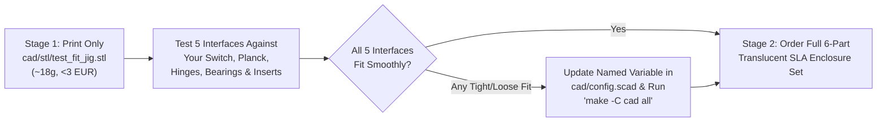

# Phase 6: 3D Print Order Specification (`docs/print-spec.md`)

This document provides the exact, order-ready configuration for manufacturing the 7 custom `ns-conv` enclosure parts in **Translucent Lilac SLA photopolymer resin** via **JLC3DP** (our selected budget option in Germany, paired with a 60-second `Rit DyeMore — Royal Purple` immersion dip) or **PCBWay** (turnkey factory-dyed alternative), along with the **Test-Fit Jig protocol** for resolving any dimensional tolerances before committing to the full shell print.

---

## 1. Two-Stage Print Strategy: Print `test_fit_jig.stl` First!

Because SLA photopolymer resins undergo `~0.10%–0.15%` UV post-cure shrinkage—and donor hardware tolerances can vary slightly between manufacturing batches—we use a **two-stage print workflow** to guarantee a perfect first-try fit on the large `306.0 × 162.0 mm` clamshell halves:

### 1.1 How to Evaluate [`cad/stl/test_fit_jig.stl`](../cad/stl/test_fit_jig.stl) Upon Arrival

| Gauge Zone on `test_fit_jig.stl` | Physical Check to Perform | Pass Criterion | If Adjustment Is Needed (`cad/config.scad`) |
| :--- | :--- | :--- | :--- |
| **1. Switch Thickness U-Jaw** *(Left end of jig: `12.20 mm` slot)* | Slide the edge of your disassembled Switch core (backplate & rails removed) into the U-jaw. | Slides in smoothly with `~0.1–0.2 mm` play per side; does not bind on the glass digitizer or rear EMI shield. | Adjust `sw_core_thick` (default `11.80`) or `sla_clear_slip` (`0.20`). |
| **2. Switch 5× Side-Rail `M2` Pitch Gauge** *(Front edge: `X = 12, 31.5, 51, 70.5, 90 mm`)* | Hold the jig edge against the left and right edges of the Switch magnesium midframe and thread `M2 × 8 mm` screws through all 5 holes at once. | All 5 `M2` screws thread smoothly into the Switch midframe without binding. | Update the `sw_rail_hole_y` array in `cad/config.scad`. |
| **3. Planck Corner Ledge & `M2` Boss** *(Top-right raised pocket)* | Drop the front-left corner of your bare Drop × MIT Planck Rev 6 (`233 × 81 mm`) into the corner shelf. | Switch plate rests flat on the `2.0 mm` ledge and the `M2` screw aligns with the PCB standoff at `(21.5, 21.5)`. | Adjust `planck_plate_t` (`1.50`) or `planck_mount_pts`. |
| **4. Southco `E6-10-301` Hinge Pattern & `MR63ZZ` Bearing Seat** *(Center of jig)* | Place one `E6-10-301` / `CL226` hinge leaf over the 4-hole pattern (`25.4 × 19.1 mm`), and snap an `MR63ZZ (3×6×2.5 mm)` bearing + `3 mm` shaft into the bearing cradle. | Hinge holes align; `MR63ZZ` outer ring spins freely without rubbing the walls. | Adjust `hinge_hole_span_x/y` or `tball_bearing_od` (`6.00`). |
| **5. Thermoset SLA Brass Insert Tolerance Ladder** *(`-0.05`, `0.00`, `+0.05 mm` test bores)* | Test-push an `M2×3×3.2 mm` and `M3×4×4.5 mm` knurled brass insert into the 3 test bores by hand / light clamp pressure. | Pick the bore where the insert presses in snugly with light clamp pressure (for CA glue bonding) without cracking the wall. | Set `m2_insert_d` (`3.15`) and `m3_insert_d` (`4.45`) to match the best hole diameter. |

---

## 2. Primary Order Configuration: JLC3DP (`SLA 8001 Translucent Resin`)

Upload the STL files from [`cad/stl/`](../cad/stl/) (or 3MF files from [`cad/3mf/`](../cad/3mf/)) to **[JLC3DP Instant Quote (`jlc3dp.com/3d-printing-quote`)](https://jlc3dp.com/3d-printing-quote)** and select these exact global parameters:

### 2.1 Global JLC3DP Order Settings
- **3D Technology:** `SLA ( Resin )`
- **Material:** **`8001 (Translucent)`**
- **Color:** `Translucent` *(natural clear/slight optical tint; dyed to Translucent Lilac in Section 3)*
- **Layer Thickness:** `0.10 mm`
- **Post-Processing / Surface Finish:** **`Sanding + Clear Oil Spraying (Translucent)`** *(Crucial: ordering factory clear-oil spraying eliminates the frosted raw layer lines so the parts arrive optically clear and ready for a 60-second lilac dye dip!)*
- **Wall Thickness Risk Confirmation:** Check `Accept` if the automated DFM viewer flags the thin `0.8 mm` recessed bumper/vent lips.
- **Units:** `mm (Millimeters)`
- **Threads / Tapping:** `None` *(All threads use captive `DIN 934` stainless hex nuts or cold-pressed knurled brass inserts—zero tapping surcharges!)*

### 2.2 Part-by-Part Quantity, Orientation & Cost Breakdown (JLC3DP)

Include this **Order Note to Engineer** in the JLC3DP checkout comment box:
> *"Please place all support structures on the INSIDE (non-cosmetic cavity side) of `base_bottom`, `base_top_deck`, `lid_rear`, and `lid_bezel`. Keep the spherical trackball cup (`Ø39.3 mm`) on `base_top_deck` and the outer cosmetic shells free of heavy support marks. Tilt large flat parts at 15–20° during printing to prevent warping."*

| File in `cad/stl/` | Qty | Dimensions (`mm`) | Est. Resin Mass | Recommended SLA Build Orientation | Est. JLC3DP Cost (EUR) |
| :--- | :-: | :---: | :---: | :--- | :---: |
| [`test_fit_jig.stl`](../cad/stl/test_fit_jig.stl) | `1` | `105.0 × 55.0 × 17.0` | `~18 g` | Flat (`Z+` up), supports on underside only | `~€2.20` |
| [`base_bottom.stl`](../cad/stl/base_bottom.stl) | `1` | `306.0 × 162.0 × 24.5` | `~128 g` | Tilted `15°–20°`, supports on **inside floor** only (keep outer bottom/sides smooth) | `~€12.50` |
| [`base_top_deck.stl`](../cad/stl/base_top_deck.stl) | `1` | `306.0 × 146.0 × 23.5` | `~92 g` | Tilted `15°–20°`, supports on **underside** only (keep top deck & spherical trackball cup support-free!) | `~€9.20` |
| [`lid_rear.stl`](../cad/stl/lid_rear.stl) | `1` | `306.0 × 162.0 × 15.0` | `~105 g` | Tilted `15°–20°`, supports on **inner Switch cavity** only (keep outer lid back smooth) | `~€10.40` |
| [`lid_bezel.stl`](../cad/stl/lid_bezel.stl) | `1` | `306.0 × 162.0 × 4.2` | `~36 g` | Tilted `20°` with full inner-face support grid to prevent thin-plate bow | `~€3.80` |
| [`battery_retainer.stl`](../cad/stl/battery_retainer.stl) | `1` | `18.0 × 96.0 × 5.2` | `~6 g` | Flat (`Z+` up) | `~€0.90` |
| [`cable_clamp.stl`](../cad/stl/cable_clamp.stl) | `1` *(pair)* | `38.0 × 26.0 × 4.5` | `~4 g` | Flat (`Z+` up) | `~€0.80` |
| **Shipping & IOSS VAT (Germany)** | — | — | `~389 g` total | *Euro Packet / YunExpress IOSS (19% German MwSt. prepaid)* | `~€10.20` |
| **Total JLC3DP Print Order** | **7 files** | | | | **`~€50.00`** |

---

## 3. Translucent Lilac Dyeing & UV Clear-Coating Protocol (For JLC3DP `8001` Parts)

When your clear-oiled `JLC3DP 8001` parts arrive, follow this 20-minute procedure using **`Rit DyeMore Synthetic — Royal Purple` (`PRT-02`)** and **Dupli-Color UV-Resistant Clear Acrylic Varnish (`PRT-03`)** to achieve a factory-grade **Translucent Lilac** finish without warping the resin:

> [!CAUTION]
> **CRITICAL TEMPERATURE LIMIT (`55°C–60°C` MAX):**
> `SLA 8001` photopolymer resin has a Heat Deflection Temperature (`HDT`) of **`56°C–58°C`**. **NEVER put SLA resin parts into boiling (`90°C–100°C`) water**, or the `306 mm` shells will soften and warp! At **`55°C–58°C`**, `Rit DyeMore Synthetic` penetrates the surface of `8001` resin in just **`45 to 90 seconds`** while keeping the parts 100% dimensionally stable.

### Step-by-Step Dyeing Procedure
1. **Clean Parts:** Wash all printed parts in lukewarm (`30°C`) water with a drop of dish soap to remove any fingerprint oils, then rinse with clean water.
2. **Prepare the Lilac Dye Bath:**
   - Use a wide, flat stainless-steel roasting pan or plastic storage tub (`>= 350 × 200 mm` so the `306 × 162 mm` shells lie completely flat without touching the sides).
   - Fill with **`2.0 Liters` of warm tap/kettle water measured at `55°C–58°C`** (verify with a kitchen thermometer).
   - Stir in **`30 ml` (2 tablespoons) of `Rit DyeMore Synthetic — Royal Purple`** and **`5 ml` (1 teaspoon) of clear dish soap** (acts as a levelling surfactant so dye absorbs evenly without streaks).
3. **Calibrate Tint Depth on `test_fit_jig` First:**
   - Submerge `test_fit_jig` into the `56°C` bath for **`30 seconds`**, pull it out, and rinse in cool water:
     - **`30–45 seconds`:** Light pastel Translucent Lilac.
     - **`60–75 seconds`:** Classic medium Translucent Lilac (Recommended!).
     - **`120+ seconds`:** Deep Atomic Purple.
4. **Dip the Main Enclosure Parts (`60–75 seconds`):**
   - Lay each shell flat in the `56°C` bath and gently agitate the water for your target time (`~60 seconds`) so all surfaces color at the exact same rate.
   - Lift the part out horizontally and **immediately submerge it in a basin of cool (`20°C`) tap water** to stop dye absorption and lock flat geometry.
5. **Dry & Apply UV-Resistant Clear Coat (`PRT-03`):**
   - Pat dry with a lint-free microfiber towel and let air-dry flat for 2 hours.
   - Mask the 3× `MR63ZZ` bearing seats inside the trackball socket with small bits of painter's tape.
   - Spray **2 light mist coats** (10 minutes apart) followed by **1 medium wet coat** of **Dupli-Color UV-Resistant Clear Acrylic Varnish (`PRT-03`)** on the exterior surfaces. This seals the lilac dye permanently, restores crystal optical translucency, and blocks UV sunlight from yellowing the SLA resin over time.

---

## 4. Turnkey Factory-Dyed Alternative: PCBWay (`SLA UTR-8100 Transparent`)

If you prefer not to dye the parts yourself and are willing to pay the higher turnkey post-processing fee (`~€165.00` shipped to Germany), upload the same 7 STL files to **[PCBWay 3D Printing (`pcbway.com`)](https://www.pcbway.com/rapid-prototyping/manufacture/?type=2)** with these exact settings:

- **3D Technology:** `SLA`
- **Material:** **`UTR-8100 (Transparent)`**
- **Layer Thickness:** `0.10 mm`
- **Surface Finish:** Check **`Dyeing`** + **`Clear Spraying (Glossy or Semi-Matte)`**
  - **Color Selection:** Select `Custom Color (Pantone)` and enter **`Pantone 2577 C` (Translucent Lilac / Pastel Violet)** *(or `Pantone 2645 C` for a slightly softer lavender-lilac)*.
  - **Order Note:** *"Please dye in translucent lilac (Pantone 2577 C, ~65% light transmission—do not over-dye opaque) and apply UV-resistant clear topcoat. Place all supports on interior cavity faces."*
