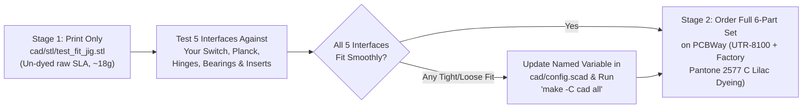

# Phase 6: 3D Print Order Specification — 100% Premade Factory-Finished (`docs/print-spec.md`)

Per your requirement that **all enclosure parts arrive 100% premade and factory-finished in Translucent Lilac with zero home dyeing or spray painting**, **PCBWay (`SLA UTR-8100 Transparent` + Factory Custom Pantone `2577 C` Immersion Dyeing + Factory UV Clear Spray)** is the required manufacturing service.

> [!NOTE]
> **Why PCBWay Instead of JLC3DP for Premade Translucent Lilac?**
> JLC3DP's `8001 Translucent` SLA resin ships clear/un-dyed and JLC3DP's factory painting service only supports 5 opaque colors (Black, White, Red, Silver, Sky Blue—no custom Pantone dyeing or translucent purple/lilac). **PCBWay** offers turnkey **factory resin dyeing to any custom Pantone code (`Pantone 2577 C` / `2645 C` Translucent Lilac) plus factory UV-resistant clear urethane spraying**, so the parts arrive at your door in Germany completely finished and ready to bolt together.

---

## 1. Two-Stage Print Strategy: Print `test_fit_jig.stl` First!

Because SLA photopolymer resins undergo `~0.10%–0.15%` UV post-cure shrinkage—and donor hardware tolerances can vary slightly between manufacturing batches—we recommend a **two-stage print workflow** to guarantee a perfect first-try fit before ordering the factory-dyed `306.0 × 162.0 mm` main shells:

### 1.1 How to Evaluate [`cad/stl/test_fit_jig.stl`](../cad/stl/test_fit_jig.stl) Upon Arrival

| Gauge Zone on `test_fit_jig.stl` | Physical Check to Perform | Pass Criterion | If Adjustment Is Needed (`cad/config.scad`) |
| :--- | :--- | :--- | :--- |
| **1. Switch Thickness U-Jaw** *(Left end of jig: `12.20 mm` slot)* | Slide the edge of your disassembled Switch core (backplate & rails removed) into the U-jaw. | Slides in smoothly with `~0.1–0.2 mm` play per side; does not bind on the glass digitizer or rear EMI shield. | Adjust `sw_core_thick` (default `11.80`) or `sla_clear_slip` (`0.20`). |
| **2. Switch 5× Side-Rail `M2` Pitch Gauge** *(Front edge: `X = 12, 31.5, 51, 70.5, 90 mm`)* | Hold the jig edge against the left and right edges of the Switch magnesium midframe and thread `M2 × 8 mm` screws through all 5 holes at once. | All 5 `M2` screws thread smoothly into the Switch midframe without binding. | Update the `sw_rail_hole_y` array in `cad/config.scad`. |
| **3. Planck Corner Ledge & `M2` Boss** *(Top-right raised pocket)* | Drop the front-left corner of your bare Drop × MIT Planck Rev 6 (`233 × 81 mm`) into the corner shelf. | Switch plate rests flat on the `2.0 mm` ledge and the `M2` screw aligns with the PCB standoff at `(21.5, 21.5)`. | Adjust `planck_plate_t` (`1.50`) or `planck_mount_pts`. |
| **4. Southco `E6-10-301` Hinge Pattern & `MR63ZZ` Bearing Seat** *(Center of jig)* | Place one `E6-10-301` / `CL226` hinge leaf over the 4-hole pattern (`25.4 × 19.1 mm`), and snap an `MR63ZZ (3×6×2.5 mm)` bearing + `3 mm` shaft into the bearing cradle. | Hinge holes align; `MR63ZZ` outer ring spins freely without rubbing the walls. | Adjust `hinge_hole_span_x/y` or `tball_bearing_od` (`6.00`). |
| **5. Thermoset SLA Brass Insert Tolerance Ladder** *(`-0.05`, `0.00`, `+0.05 mm` test bores)* | Test-push an `M2×3×3.2 mm` and `M3×4×4.5 mm` knurled brass insert into the 3 test bores by hand / light clamp pressure. | Pick the bore where the insert presses in snugly with light clamp pressure (for CA glue bonding) without cracking the wall. | Set `m2_insert_d` (`3.15`) and `m3_insert_d` (`4.45`) to match the best hole diameter. |

---

## 2. Turnkey Order Configuration: PCBWay (`SLA UTR-8100 Transparent` + Factory Lilac Dyeing)

Upload the STL files from [`cad/stl/`](../cad/stl/) (or 3MF files from [`cad/3mf/`](../cad/3mf/)) to **[PCBWay 3D Printing Instant Quote (`pcbway.com/rapid-prototyping/manufacture/?type=2`)](https://www.pcbway.com/rapid-prototyping/manufacture/?type=2)** and select these exact settings:

### 2.1 Global PCBWay Checkout Settings
- **3D Technology:** `SLA (Stereolithography)`
- **Material:** **`UTR-8100 (Transparent)`** *(Choose `UTR-8100 (Transparent)` for a glossy, glass-like retro Game Boy Atomic Purple/Lilac look, or `UTR-8100 (Translucent)` for a slightly softer frosted-glass lilac look)*
- **Color:** `Transparent` *(Base resin color; the lilac tint is selected under Surface Finish below)*
- **Layer Thickness:** `0.10 mm` *(Standard high-precision SLA)*
- **Surface Finish (Post-Processing):**
  1. Select **`Dyeing`** → Choose **`Custom Color (Pantone)`** → Enter **`Pantone 2577 C`** *(Bright Translucent Lilac)* or **`Pantone 2645 C`** *(Pastel Lavender-Lilac)*.
  2. Select **`Clear Spraying`** *(Factory-applied UV-resistant clear urethane topcoat that seals the dye and gives optical clarity)*.
- **Wall Thickness Risk Confirmation:** Check `Accept thin wall risk` if prompted by automated DFM for the `0.8 mm` recessed bumper seats.
- **Units:** `mm (Millimeters)`
- **Tapping / Threaded Inserts:** `No` *(All screw bosses use captive `DIN 934` stainless hex nuts or cold-press brass inserts to avoid manual tapping fees).*

### 2.2 Copy-Paste Special Instruction for the PCBWay Engineer
Paste the following instruction into the **"Other Special Requirements"** box on PCBWay:
> *"1. DYEING: Please immersion-dye all parts in TRANSLUCENT LILAC matching Pantone 2577 C (keep ~65%–70% light transmission so internal ribs and electronics remain visible through the shell; do not paint opaque) and finish with UV-resistant clear coat.*
> *2. ORIENTATION & SUPPORTS: Please place all support structures on the INSIDE (non-cosmetic cavity side) of `base_bottom`, `base_top_deck`, `lid_rear`, and `lid_bezel`. Keep the spherical trackball cup (`Ø39.3 mm`) on `base_top_deck` and the outer cosmetic shells free of heavy support marks.*
> *3. MASKING: Do not apply thick clear coat inside the three small bearing slots inside the `base_top_deck` trackball cup or inside the `M2`/`M3` blind insert holes."*

---

## 3. Part-by-Part Quantity, Orientation & Turnkey Cost Breakdown (PCBWay → Germany)

| File in `cad/stl/` | Qty | Dimensions (`mm`) | Est. Resin Mass | Recommended SLA Build Orientation | Est. Base Print (EUR) | Est. Factory Lilac Dye + Clear Coat (EUR) | Line Total (EUR) |
| :--- | :-: | :---: | :---: | :--- | :---: | :---: | :---: |
| [`test_fit_jig.stl`](../cad/stl/test_fit_jig.stl) | `1` | `105.0 × 55.0 × 17.0` | `~18 g` | Flat (`Z+` up), ordered *un-dyed* in Stage 1 | `~€4.50` | `€0.00` *(Stage 1 raw)* | `~€4.50` |
| [`base_bottom.stl`](../cad/stl/base_bottom.stl) | `1` | `306.0 × 162.0 × 24.5` | `~128 g` | Tilted `15°–20°`, supports on **inside floor** only | `~€24.00` | `~€16.00` | `~€40.00` |
| [`base_top_deck.stl`](../cad/stl/base_top_deck.stl) | `1` | `306.0 × 146.0 × 23.5` | `~92 g` | Tilted `15°–20°`, supports on **underside** only (keep top deck & trackball cup support-free) | `~€18.50` | `~€15.00` | `~€33.50` |
| [`lid_rear.stl`](../cad/stl/lid_rear.stl) | `1` | `306.0 × 162.0 × 15.0` | `~105 g` | Tilted `15°–20°`, supports on **inner Switch cavity** only | `~€20.50` | `~€15.50` | `~€36.00` |
| [`lid_bezel.stl`](../cad/stl/lid_bezel.stl) | `1` | `306.0 × 162.0 × 4.2` | `~36 g` | Tilted `20°` with full inner-face support grid | `~€9.50` | `~€12.00` | `~€21.50` |
| [`battery_retainer.stl`](../cad/stl/battery_retainer.stl) | `1` | `18.0 × 96.0 × 5.2` | `~6 g` | Flat (`Z+` up) | `~€2.50` | `~€4.00` | `~€6.50` |
| [`cable_clamp.stl`](../cad/stl/cable_clamp.stl) | `1` *(pair)* | `38.0 × 26.0 × 4.5` | `~4 g` | Flat (`Z+` up) | `~€2.00` | `~€3.50` | `~€5.50` |
| **Shipping & IOSS VAT (Germany)** | — | — | `~389 g` total | *DHL / PCBWay Air Line IOSS (incl. 19% German MwSt.)* | — | — | `~€17.50` |
| **Total Turnkey PCBWay Order** | **7 files** | | | **Arrives 100% Factory-Dyed in Translucent Lilac** | **`~€81.50`** | **`~€66.00`** | **`~€165.00`** |

> [!TIP]
> **Tip to Reduce PCBWay's Per-File Dyeing Fee (`Saves ~€18–€22`):**
> Because PCBWay calculates dyeing/polishing setup fees per uploaded STL file, you can upload `battery_retainer.stl` and `cable_clamp.stl` **un-dyed (`UTR-8100 Transparent` + `Clear Spraying` only, no dyeing fee)** since they sit hidden *inside* the base and lid! Leaving those two small internal brackets clear-transparent reduces the PCBWay turnkey total from **`~€165.00` down to `~€145.00`**.
