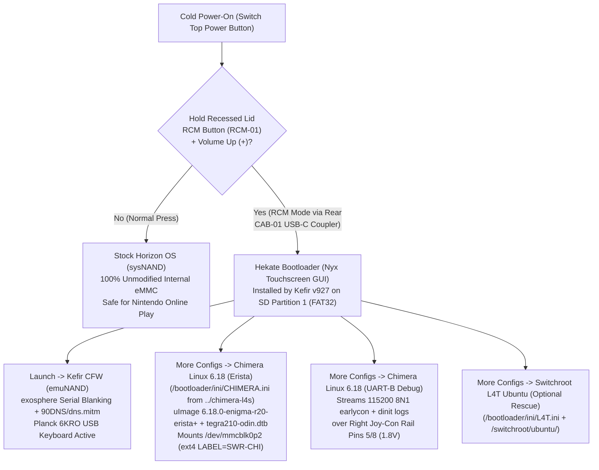

# Phase 8: Complete Software Setup Guide — Kefir CFW + `chimera-l4s` (Linux 6.18 Enigma R20) (`docs/software.md`)

This guide provides the complete, step-by-step software setup for the **`ns-conv`** clamshell cyberdeck, combining:
1. **Unmodified Stock Horizon OS (`sysNAND`):** 100% clean internal eMMC for legitimate online Nintendo Switch gameplay.
2. **Horizon OS Custom Firmware via [Kefir (`v927`)](https://github.com/rashevskyv/kefir/releases/tag/927):** Atmosphère + Hekate Nyx GUI + `exosphere` serial blanking + `dns.mitm` Nintendo telemetry blocking on **`emuNAND`**.
3. **Chimera Linux `aarch64` (`musl` + `dinit`) with Linux `6.18.0-enigma-r20-erista+` via [`../chimera-l4s`](file:///Users/jonasnowak/Documents/repos/chimera-l4s) ([`JonasNowak/chimera-switch-6.18`](https://github.com/JonasNowak/chimera-switch-6.18)):** Mainline-tracking `linux-nx` 6.18 kernel with Enigma R20 patches, Erista Device Tree (`tegra210-odin.dtb`), USB-C CDC-NCM Ethernet (`usb0` at `10.42.0.2/24` + OpenSSH), and built-in Tegra X1 xHCI USB HID support for the **Drop × MIT Planck keyboard** and **38 mm Trackball**.
4. **Optional Co-Existing [Switchroot L4T Ubuntu 24.04 (Noble)](https://wiki.switchroot.org/wiki/linux/l4t-ubuntu-noble-installation-guide) Rescue Path (`L4T 4.9`):** Preserved in `/bootloader/ini/L4T.ini` and `/switchroot/ubuntu/` for full hardware-accelerated desktop GUI & onboard Broadcom Wi-Fi while Enigma R20/R21 PCIe LTSSM is brought up.

---

## 1. Multi-Boot Architecture on the Clamshell Cyberdeck



---

## 2. `emuNAND` vs. `sysNAND` Comparison & Ban-Risk Trade-Offs (Kefir `v927`)

Kefir supports running Atmosphère CFW on either **`emuNAND` (SD Card)** or **`sysNAND` (Internal eMMC)**. Below are the exact ban-risk and partition-layout trade-offs for our cyberdeck:

| Configuration | Ban Risk | SD Space Used | How It Interacts with `chimera-l4s` (`LABEL=SWR-CHI`) | Recommendation |
| :--- | :--- | :---: | :--- | :--- |
| **Option 1: File-Based `emuNAND` on FAT32 (`mmcblk0p1`) + Clean `sysNAND`** | **Near-Zero on `sysNAND`** (`emuNAND` uses Kefir `exosphere.ini` + `dns.mitm`) | `~29.8 GB` inside `/emuMMC/SD00/` on `p1` | **Best compatibility with `chimera-l4s`!** Keeps the SD card as a clean **2-partition MBR layout**: `mmcblk0p1` (`FAT32`) + `mmcblk0p2` (`ext4`, `LABEL=SWR-CHI`). `rootdev=mmcblk0p2` in [`CHIMERA.ini`](file:///Users/jonasnowak/Documents/repos/chimera-l4s/out/sd-boot/bootloader/ini/CHIMERA.ini) works unmodified! | **Strongly Recommended for `chimera-l4s` + Kefir** |
| **Option 2: SD Partition `emuNAND` (`mmcblk0p3`) + Clean `sysNAND`** | **Near-Zero on `sysNAND`** (`emuNAND` uses Kefir `exosphere.ini` + `dns.mitm`) | `29.1 GB` raw partition (`12–15%` faster I/O than file-based) | Creates a **3-partition MBR layout**. If Hekate places `emuMMC` on `p2` and Linux `ext4` on `p3`, you must set `rootdev=mmcblk0p3` in `bootloader/ini/CHIMERA.ini` (automated by [`software/deploy-chimera-kefir-sd.sh`](../software/deploy-chimera-kefir-sd.sh)). | **Recommended if you prioritize maximum `emuNAND` load speed** |
| **Option 3: CFW Directly on `sysNAND` (No `emuNAND`)** | **HIGH (Permanent Console Ban Risk)** | `0 GB` | Even with Airplane Mode or `90DNS`, any homebrew NSP, custom profile icon, or crash report written to `sysNAND` telemetry logs will trigger a ban as soon as `sysNAND` reconnects to Nintendo servers. | **Do Not Use if You Care About Online Play** |

### Three Layers of Ban Protection Included in Kefir (`v927`)
1. **`exosphere.ini` (Incognito / PRODINFO Blanking on `emuNAND`):** Automatically zeroes out your Switch's serial number (`XAW00000000000`) in memory whenever booted into `emuNAND`, while leaving the real serial intact in `sysNAND`.
2. **`dns.mitm` (`atmosphere/hosts/default.txt`):** Kernel-level hostname redirection built into Atmosphère that blocks all `*.nintendo.net`, `*.nintendo.com`, and `receive-lp1.dg.srv.nintendo.net` telemetry servers across every Wi-Fi network (stronger than manual `90DNS` IP settings, which only apply per Wi-Fi SSID).
3. **Strict `emmc=0` Enforcement in `chimera-l4s`:** In [`../chimera-l4s/out/sd-boot/bootloader/ini/CHIMERA.ini`](file:///Users/jonasnowak/Documents/repos/chimera-l4s/out/sd-boot/bootloader/ini/CHIMERA.ini), `emmc=0` and `/etc/fstab` (`LABEL=SWR-CHI`) guarantee that Chimera Linux never mounts or touches internal eMMC (`/dev/mmcblk1`).

---

## 3. How `chimera-l4s` (`6.18.0-enigma-r20-erista+`) Works with the Cyberdeck Hardware

We inspected [`../chimera-l4s/configs/chimera-erista-r20.config`](file:///Users/jonasnowak/Documents/repos/chimera-l4s/configs/chimera-erista-r20.config) and [`../chimera-l4s/README.md`](file:///Users/jonasnowak/Documents/repos/chimera-l4s/README.md) to verify how every cyberdeck hardware subsystem interacts with your Linux 6.18 build:

| Cyberdeck Hardware Subsystem | Kernel / Driver Status in `chimera-l4s` (`6.18.0-enigma-r20-erista+`) | Operational Notes & Workarounds |
| :--- | :--- | :--- |
| **Drop × MIT Planck Keyboard (`DON-02`)** | **Built-in (`=y`):** `CONFIG_USB_XHCI_TEGRA=y`, `CONFIG_USB_HID=y`, `CONFIG_HID_GENERIC=y`, `CONFIG_INPUT_KEYBOARD=y`, `CONFIG_VT_CONSOLE=y` | Works immediately on Linux virtual terminals (`tty1`) and under Horizon OS (ensure QMK `NKRO` is toggled **OFF** via `Lower + Raise + N` for Horizon OS `6KRO` compatibility). |
| **38 mm Trackball (`PER-01`)** | **Built-in (`=y`):** `CONFIG_USB_HID=y`, `CONFIG_HID_GENERIC=y`, `CONFIG_INPUT_MOUSEDEV=y` (`1280×720`) | Enumerates immediately via `xhci-tegra` on `/dev/input/mice` and `/dev/input/event*` when `HUB-01` is connected. |
| **Rear Center USB-C Coupler Pocket (`CAB-01`)** | **Dual-Role (`tegra-xudc` Gadget vs. `xhci-tegra` Host)** | • **Plugged into Mac:** `dinit` starts `/etc/dinit.d/usb-gadget` (`CDC-NCM` USB Ethernet on `usb0` at `10.42.0.2/24` + `ACM` serial `/dev/cu.usbmodem*`) for headless `ssh chimera@10.42.0.2`.<br>• **Plugged into Internal `HUB-01`:** Switch runs in USB Host mode (`xhci-tegra`) powering the Planck, Trackball, and exposed right-side `USB-A 3.0` port while receiving `15V PD` power from the INIU power bank. |
| **Wi-Fi / Networking in Linux 6.18 vs. Horizon OS** | • **Horizon OS & L4T 4.9:** Onboard Broadcom `BCM4356` 2.4/5 GHz Wi-Fi works natively through the RF-transparent SLA lid.<br>• **`chimera-l4s` (Linux 6.18 R20):** Onboard PCIe Wi-Fi (`brcmfmac`) is currently blocked upstream by the Tegra PCIe LTSSM timeout (`enigma-r20-ltssm.patch`). | In `chimera-l4s` 6.18, network access works via: **(a)** USB-C Ethernet gadget (`usb0`, `10.42.0.2/24`) to your Mac, or **(b)** plugging a standard **USB-A Ethernet or USB Wi-Fi dongle** into the cyberdeck's **exposed right-side `USB-A 3.0` port (`HUB-01`)**! |
| **Right Joy-Con Rail `1.8V` UART-B Debug (`Pin 5 TX` / `Pin 8 RX`)** | **Supported (`uart_port=2`, `earlycon=1`)** via the `Chimera Linux 6.18 (UART-B Joy-Con Debug)` entry in `CHIMERA.ini` | Your spare Right Joy-Con rail flex inside the lid (`DON-03`) is already wired for Pin 10 (`RCM-01`) and Pin 1 (`GND`). Tapping **Pin 5 (`TX`)** and **Pin 8 (`RX`)** with a `1.8V` TTL USB-UART adapter captures full ATF (`bl31`), U-Boot (`bl33`), and Linux 6.18 `earlycon` logs at `115200 8N1`. |

---

## 4. Step-by-Step Installation: Combining Kefir `v927` + `chimera-l4s` on Your microSD Card

All pre-built Chimera Linux 6.18 artifacts are already compiled and verified in [`/Users/jonasnowak/Documents/repos/chimera-l4s/out/`](file:///Users/jonasnowak/Documents/repos/chimera-l4s/out):
- [`../chimera-l4s/out/chimera-switch-erista.img`](file:///Users/jonasnowak/Documents/repos/chimera-l4s/out/chimera-switch-erista.img) (`1.88 GB` flashable 2-partition image: `p1` `SWITCHBOOT` FAT32 + `p2` `SWR-CHI` ext4)
- [`../chimera-l4s/out/sd-boot/`](file:///Users/jonasnowak/Documents/repos/chimera-l4s/out/sd-boot) (`bootloader/ini/CHIMERA.ini` + `switchroot/chimera/*`)
- [`../chimera-l4s/out/rootfs.tar.zst`](file:///Users/jonasnowak/Documents/repos/chimera-l4s/out/rootfs.tar.zst) (`159 MB` Chimera Linux `aarch64` rootfs archive with `6.18.0-enigma-r20-erista+` modules)

### Step 4.1: Partition the microSD Card (`256 GB` Recommended)

You have two clean ways to prepare the microSD card on macOS:

#### Path A — Fast Turnkey Image Flash + Partition Expansion (Recommended for Dedicated Test Card)
1. Flash [`/Users/jonasnowak/Documents/repos/chimera-l4s/out/chimera-switch-erista.img`](file:///Users/jonasnowak/Documents/repos/chimera-l4s/out/chimera-switch-erista.img) onto your microSD card using [balenaEtcher](https://etcher.balena.io/) or the interactive script in `chimera-l4s`:
   ```bash
   cd /Users/jonasnowak/Documents/repos/chimera-l4s
   ./scripts/make-sd.sh --device /dev/diskX
   ```
2. This creates:
   - **Partition 1 (`/dev/mmcblk0p1`, `FAT32`, Label `SWITCHBOOT`):** Pre-populated with `/bootloader/ini/CHIMERA.ini` and `/switchroot/chimera/`.
   - **Partition 2 (`/dev/mmcblk0p2`, `ext4`, Label `SWR-CHI`):** Pre-populated with the Chimera Linux `aarch64` rootfs and `6.18.0-enigma-r20-erista+` kernel modules.

#### Path B — Large Multi-Boot Card via Hekate Partition Manager (Kefir `emuNAND` + Chimera Linux 6.18)
1. Format your `256 GB` microSD card as `FAT32` (`MBR / Master Boot Record`) on macOS and extract the latest **[Kefir `v927` release (`kefir927.zip`)](https://github.com/rashevskyv/kefir/releases/tag/927)** to the root of the SD card.
2. Insert the SD card into the cyberdeck's bottom-lid microSD slot, hold the recessed **`RCM-01` button + `Volume +`**, press **`Power`**, and inject `payload.bin` (Hekate) from your Mac via the rear `CAB-01` USB-C coupler.
3. In Hekate's touchscreen Nyx GUI, tap **`Tools → Partition SD Card`**:
   - **FAT32 (`hos_data`):** Drag slider to allocate `~160–190 GB` (for Horizon OS games + File-Based `emuMMC`).
   - **Linux (`EXT4`):** Drag slider to allocate `32–64 GB` (becomes `/dev/mmcblk0p2`, formatted as `ext4`).
   - **emuMMC (`RAW`):** Leave at `0 GB` if using **File-Based `emuMMC`** (keeps Linux on `mmcblk0p2`), or set to `29 FULL` if using **SD Partition `emuMMC`**.
   - Tap **`Next Step → Start`** to partition.
4. Populate the Linux `ext4` partition (`LABEL=SWR-CHI`) with [`../chimera-l4s/out/rootfs.tar.zst`](file:///Users/jonasnowak/Documents/repos/chimera-l4s/out/rootfs.tar.zst) and copy the `sd-boot` files using the automated deployment script in Step 4.2 below.

---

### Step 4.2: Run the Automated `ns-conv` SD Deployment Script (`software/deploy-chimera-kefir-sd.sh`)

With the microSD card's `FAT32` partition mounted on your Mac (either via a card reader or via **`Hekate → Tools → USB Tools → SD Card`** over the rear USB-C coupler), run [`software/deploy-chimera-kefir-sd.sh`](../software/deploy-chimera-kefir-sd.sh) from this repository:

```bash
cd /Users/jonasnowak/Documents/repos/ns-conv
./software/deploy-chimera-kefir-sd.sh --sd-mount /Volumes/SWITCHBOOT
```

What this script does automatically:
1. Verifies all SHA256 checksums in [`../chimera-l4s/out/sd-boot/MANIFEST.sha256`](file:///Users/jonasnowak/Documents/repos/chimera-l4s/out/sd-boot/MANIFEST.sha256) (`bl31.bin`, `bl33.bin`, `uImage`, `initramfs`, `nx-plat.dtimg`, `tegra210-odin.dtb`).
2. Downloads and extracts **Kefir `v927`** (or merges with an existing Kefir install on the SD card) while preserving `exosphere.ini` and `atmosphere/hosts/default.txt`.
3. Copies `/bootloader/ini/CHIMERA.ini` and `/switchroot/chimera/*` onto the `FAT32` partition without touching any existing `/bootloader/ini/L4T.ini` or `/switchroot/ubuntu/` rescue installation.
4. Checks whether your SD card has an `emuMMC` raw partition (`--rootdev mmcblk0p2` vs `mmcblk0p3`) and updates `rootdev=` in `CHIMERA.ini` accordingly.

---

### Step 4.3: Create `emuNAND` & Backup `sysNAND` in Hekate (Mandatory Before CFW Boot)

1. Boot into **Hekate Nyx GUI** on the cyberdeck touchscreen.
2. **Backup Clean `sysNAND` First:**
   - Tap **`Tools → Backup eMMC`**.
   - Tap **`eMMC BOOT0 & BOOT1`**, then **`eMMC RAW GPP`** (`rawnand.bin`). Store a copy of `/backup/` on your Mac.
3. **Create `emuMMC` (`emuNAND`):**
   - Tap **`emuMMC` (on the home screen) → `Create emuMMC`**.
   - Select **`SD File`** (if you chose Option 1 to keep `/dev/mmcblk0p2` as `SWR-CHI`) or **`SD Partition`** (if you allocated a raw partition in Step 4.1).
   - Once complete, confirm the green **`emuMMC: Enabled!`** status badge appears in the `emuMMC` panel.

---

## 5. Booting & Operating Each OS in the Clamshell Cyberdeck

### 5.1 Booting Unmodified Stock Horizon OS (`sysNAND`) — No Dongle Required
- Leave `AutoRCM` **OFF**.
- Simply press the top-edge **Switch Power Button** normally (do **not** hold the recessed `RCM-01` button).
- The console boots straight into clean Stock `sysNAND` Horizon OS.

### 5.2 Booting Kefir CFW (`emuNAND`)
1. Power the Switch completely **OFF**.
2. Unplug `HUB-01` inside the rear center coupler pocket and connect `CAB-01` to your Mac (or portable RCM dongle).
3. Insert a paperclip/stylus tip lightly onto the recessed **Right-Wing RCM Button (`RCM-01`)**, hold **`Volume +`**, and tap **`Power`**.
4. Inject `payload.bin` (Kefir's Hekate payload) from macOS (`webcfw.sh` or `fusee-launcher.py`).
5. Reconnect `HUB-01` to `CAB-01` inside the rear pocket and flip the rear power bank switch **`ELC-02` ON**.
6. On the Switch touchscreen in Hekate, tap **`Launch → Kefir (emuMMC)`**.

### 5.3 Booting `chimera-l4s` (`Chimera Linux 6.18.0-enigma-r20-erista+`)
1. In Hekate Nyx GUI, tap **`More Configs`**.
2. Tap **`Chimera Linux 6.18 (Erista)`** (or **`Chimera Linux 6.18 (UART-B Joy-Con Debug)`** if capturing `1.8V` serial logs on Right Joy-Con Rail Pins 5/8).
3. **For Headless USB-SSH Bring-Up (`usb0`):**
   - Keep `CAB-01` connected to your Mac. Within 15 seconds, `tegra-xudc` enumerates as `Switch Erista USB Network` (`10.42.0.2/24`).
   - From macOS Terminal:
     ```bash
     ssh chimera@10.42.0.2
     # Default password: chimera (escalate via: doas -s)
     ```
   - Run the verification commands and record your Erista bring-up output in [`/Users/jonasnowak/Documents/repos/chimera-l4s/docs/TEST-REPORT.md`](file:///Users/jonasnowak/Documents/repos/chimera-l4s/docs/TEST-REPORT.md):
     ```bash
     uname -a
     cat /sys/firmware/devicetree/base/model && echo
     dinitctl list
     lsusb
     dmesg | grep -E "input|hid|usb|xudc|xhci"
     ```
4. **For Standalone Cyberdeck Input Mode (`xhci-tegra`):**
   - Plug `HUB-01` into the rear `CAB-01` coupler and flip `ELC-02` **ON**.
   - The **Drop × MIT Planck keyboard** and **38 mm Trackball** enumerate over `xhci-tegra` (`CONFIG_USB_XHCI_TEGRA=y`, `CONFIG_USB_HID=y`), and the right-side exposed **`USB-A 3.0` port** accepts any USB Ethernet or USB Wi-Fi adapter (`ax88179_178a` / `r8152` / `cdc_ether`).
