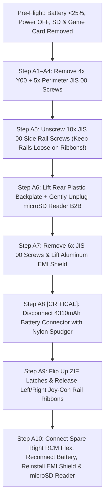
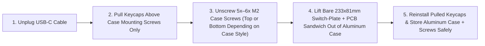

# Phase 3: Non-Destructive Teardown Plan (`docs/teardown.md`)

This guide provides a step-by-step, shop-floor disassembly procedure for both donor devices:
1. **Nintendo Switch v1 (`MOD. HAC-001`, 2017 Erista)** — Partial, 100% reversible teardown that removes only the outer plastic backplate and detachable Left/Right Joy-Con rails while keeping the factory-bonded LCD, digitizer, magnesium midframe, mainboard, thermal assembly, and 4310 mAh battery intact.
2. **Drop × OLKB MIT Planck (Rev 6.x)** — Extraction of the `233.0 × 81.0 mm` switch-plate + hotswap PCB assembly from its aluminum case.

Every step that carries a risk of component damage is flagged with an explicit **`[RISK / IRREVERSIBILITY WARNING]`** callout.

---

## 1. Pre-Disassembly Safety Gate (Mandatory Stop-Work Checks)

Before loosening a single fastener, complete all five checks below:

1. **RCM (`fusee-gelee`) Verification Complete:** Confirm that your Switch has already passed the live RCM payload injection test (`0x7000` smash bytes into Hekate) documented in [`docs/research.md`](research.md#22-mandatory-live-rcm-fusee-gelee-test-before-disassembly).
2. **Discharge Internal Battery Below 25%:** If the Switch battery is above 30%, run a game or Linux benchmark until the battery indicator drops below **25%**. *Why: A lithium-polymer pouch cell below 25% state-of-charge stores minimal thermal energy, drastically reducing fire/runaway risk if accidentally stressed.*
3. **Full Power-Off (NOT Sleep Mode):** Hold the **Power** button for 3 seconds → select **Power Options** → **Turn Off**. Wait 15 seconds after the backlight extinguishes.
4. **Remove All External Media & Controllers:**
   - Detach both Left and Right Joy-Cons.
   - Eject any Game Card from the top slot.
   - Open the rear kickstand and eject the **microSDXC card** (if installed).
5. **ESD & Fastener Organization:** Work on a clean, non-conductive mat, ground yourself before touching exposed PCBs, and place removed screws into a labeled magnetic compartmentalized tray—**Switch screw lengths vary by `0.5 mm` to `2.5 mm`, and driving a long screw into a short blind boss will puncture the front bezel or damage PCB traces.**

---

## 2. Required Tools & Fastener Map

### 2.1 Required Tools
- **`Y00` (1.5 mm) Tri-Point Precision Driver** *(for the 4 corner screws on the Switch rear plastic shell)*
- **`JIS 00` / `PH00` Precision Driver** *(for all Joy-Con rail, top/bottom bezel, microSD, and EMI shield screws — a true `JIS 00` tip prevents cam-out on Nintendo's soft screws)*
- **Hex `H1.5` / `PH0` Driver** *(for Drop Planck Rev 6 case screws)*
- **Nylon Spudger (Flat & Pointed Ends)** *(for battery connector & ZIF latch actuation — NEVER use metal tweezers on battery or ZIF connectors)*
- **ESD-Safe Angled Tweezers** *(for guiding ribbon tails and coaxial antenna routing only)*
- **Keycap Puller & Digital Calipers (`0.01 mm` resolution)**

### 2.2 Nintendo Switch v1 (`HAC-001`) Fastener Reference Map

| Step | Location | Driver Bit | Thread & Length | Qty | Disposition in Cyberdeck Build |
| :--- | :--- | :---: | :--- | :---: | :--- |
| **A1** | Rear Plastic Backplate Corners | **`Y00` Tri-Point** | `M1.7 × 6.3 mm` (self-tapping) | 4 | Store in labeled bag with stock plastic backplate |
| **A2** | Bottom Edge (Flanking USB-C Port) | **`JIS 00`** | `M2.0 × 3.0 mm` (machine thread) | 2 | **Reuse** (or replace with `M2×5 mm` in custom lid bottom retainer) |
| **A3** | Top Edge (Center Vent) | **`JIS 00`** | `M2.0 × 3.0 mm` (machine thread) | 1 | **Reuse** in custom lid top vent bracket |
| **A4** | Under Kickstand (microSD Slot Area) | **`JIS 00`** | `M1.7 × 2.5 mm` (ultra-short!) | 2 | Store in labeled bag with stock backplate |
| **A5** | Left & Right Joy-Con Side Rails (`5 per side`) | **`JIS 00`** | `M2.0 × 3.5 mm` (countersunk machine) | 10 *(5L + 5R)* | Store with OEM rails; **the 10 M2 threaded midframe holes are reused with `M2×8 mm` stainless screws to bolt the Switch core into the lid!** |
| **A6** | microSD Card Reader Board | **`JIS 00`** | `M1.7 × 3.0 mm` (black washer-head) | 1 | **Reinstall immediately** in Step A10 after reattaching EMI shield |
| **A7** | Rear Aluminum EMI Shield | **`JIS 00`** | `M1.7 × 3.8 mm` (silver pan-head) | 6 | **Reinstall in Step A9** (or swap outer 4 with longer `M1.7/M2` standoffs if using rear lid bosses) |

---

## 3. Part A: Nintendo Switch v1 (`HAC-001`) Non-Destructive Disassembly

### Step A1–A4: Remove the Rear Plastic Backplate Fasteners
1. Place the Switch face-down on a soft, lint-free microfiber cloth (protecting the front digitizer glass).
2. **`[WARNING — Screw Stripping]`** Using the **`Y00` Tri-Point driver**, apply firm downward axial pressure and remove the **4× `6.3 mm` `Y00` screws** at the four corners of the rear plastic backplate. *If your driver slips even once, stop and check that you are using `Y00` (not `Y0` or `Y000`).*
3. Switch to the **`JIS 00` driver**:
   - Remove the **2× `M2 × 3.0 mm` screws** flanking the bottom USB-C port.
   - Remove the **1× `M2 × 3.0 mm` screw** centered on the top edge next to the exhaust vent.
   - Flip open the rear kickstand and remove the **2× ultra-short `2.5 mm` screws** inside the kickstand recess.

### Step A5: Unscrew the Left & Right Joy-Con Rails (Do NOT Pull Away Yet!)
1. Using the **`JIS 00` driver**, remove the **5× `M2 × 3.5 mm` black countersunk screws** along the **Left Joy-Con rail** and the **5× `M2 × 3.5 mm` screws** along the **Right Joy-Con rail**.
2. **`[CRITICAL WARNING — Fragile Joy-Con Rail Flex Cables]`**
   > [!CAUTION]
   > **DO NOT pull the Joy-Con rails away from the console yet!** Each rail is tethered to the inside of the mainboard by a thin 10-pin flexible printed circuit (FPC) ribbon passing through a slot in the magnesium midframe. Pulling a loose rail now will tear the ribbon in half. Leave both rails resting loosely in their side channels or secure them temporarily with a strip of painter's tape until Step A9.

### Step A6: Lift the Rear Plastic Backplate & Remove the microSD Reader Board
1. Gently lift the bottom edge of the rear plastic backplate (near the USB-C port) upward by `~5 mm`, then slide it slightly toward the top edge to clear the headphone jack lip and remove the backplate completely. Store the backplate and kickstand safely.
2. You will now see the **silver aluminum EMI shield** and the small **microSD card reader daughterboard** sitting on top of the shield in the bottom-left quadrant:
   - Remove the **1× `JIS 00` black screw** securing the microSD reader board.
   - **`[WARNING — Press-Fit Board-to-Board Connector & Foam Gasket]`** Using the flat tip of a **nylon spudger** directly under the top edge of the microSD PCB, gently pry straight up (`90°` perpendicular to the mainboard) to pop its tiny 16-pin press-fit board-to-board (`B2B`) connector free. *Do not twist or lever against the fragile black conductive sponge gasket surrounding the connector.* Set the microSD board in an ESD bag until Step A10.

### Step A7: Remove the Rear Aluminum EMI Shield
1. Remove the **6× `JIS 00` silver pan-head screws** around the perimeter of the aluminum EMI shield.
2. **`[NOTE — Thermal Paste on Heatpipe]`** When you lift the aluminum EMI shield straight up, you will notice a patch of grey/pink high-viscosity thermal putty (`Shin-Etsu` gap filler) in the center where the copper heatpipe transfers heat to the EMI shield.
   - Keep the inside of the EMI shield facing upward on a clean paper towel so dust does not stick to the thermal putty—we will reinstall this exact EMI shield in Step A10 to preserve the factory thermal path!

### Step A8: Immediately Disconnect the Internal 4310 mAh Battery
> [!CAUTION]
> **`[CRITICAL ELECTRICAL SAFETY WARNING]`**
> Before touching **any** ribbon cable latch on the mainboard, you **MUST** disconnect the internal battery. Unplugging or plugging ZIF ribbons while the mainboard's `3.3V` / `1.8V` standby rails are live can short adjacent pins and blow the `BQ24193` power management IC or backlight boost converter.

1. Locate the white/black 5-wire **Battery Connector** at the bottom-right edge of the battery bay (just left of the lower part of the mainboard).
2. Using the flat nylon spudger (never metal!), pry **straight upward** (`90°` away from the mainboard surface) under the wires/lip of the battery plug until it pops vertically out of its board header. *(It is a vertical board-to-board Molex header, NOT a horizontal sliding plug!)*
3. Bend the battery wires slightly back by `2 mm` so the plug cannot accidentally spring back onto the header pins while you work.

### Step A9: Safely Release the Left & Right Joy-Con Rail ZIF Ribbons
1. Locate the **Left Joy-Con Rail ZIF Connector** (middle-left edge of the battery/midframe pass-through) and the **Right Joy-Con Rail ZIF Connector** (lower-right edge of the mainboard).
2. **`[CRITICAL WARNING — ZIF Flip Latches]`**
   - Using the pointed tip of your nylon spudger, gently flip the tiny black plastic locking bail **upward `90°`** to unlock the ZIF socket. *Never pry the housing base itself—only flip the hinged actuator tab.*
   - Use angled tweezers to slide the Left and Right Joy-Con rail ribbons smoothly out of their sockets and thread them out through the side slots of the magnesium midframe.
3. Place both original OEM Left and Right Joy-Con rails (along with their 10 screws) in a labeled zip-top bag for 100% future reversibility.

### Step A10: Do-Not-Touch Zones, Spare RCM Flex Installation & Core Button-Up
> [!WARNING]
> **`[DO-NOT-TOUCH ZONES — PRESERVE FACTORY INTEGRITY]`**
> Because the Switch core mounts into our upper lid as a complete unit, **DO NOT disconnect or disturb any of the following components:**
> 1. **Glued 4310 mAh LiPo Battery (Left Half):** Never pry or apply alcohol to the battery pouch. It stays factory-glued in its magnesium midframe tray.
> 2. **53-Pin LCD MIPI DSI ZIF Connector (Bottom-Center of Mainboard, under battery tray lip):** Has an ultra-fragile gold locking bail. Leave 100% untouched.
> 3. **34-Pin Capacitive Digitizer ZIF & 4-Pin Backlight ZIF (Right Edge near Game Card Reader):** Leave 100% untouched.
> 4. **Black & White Coaxial Wi-Fi / Bluetooth Antenna Cables (`U.FL` / `MHF1`, Right Edge):** Leave snapped onto their PCB jacks and routed inside their factory midframe clips.
> 5. **Copper Heatpipe & Cooling Fan:** Leave the 3-screw heatpipe and fan bolted to the SoC and magnesium midframe.

1. **Install the Spare Right Joy-Con RCM Trigger Flex (`DON-03` + `RCM-01`):**
   - Take your **spare Right Joy-Con rail flex cable** (prepared in Part B below with two thin `30 AWG` leads wired from **Pin 10 (`HOME/RCM`)** and **Pin 1 (`GND`)** to the `6×6×5 mm` momentary tactile button).
   - Thread the ribbon tail through the right-side midframe slot, slide the gold fingers fully into the **Right Joy-Con ZIF socket** on the mainboard (up to the white insertion line), and press the black ZIF locking bail flat (`0°`) to lock it.
2. **Reconnect the Internal Battery:**
   - Align the 5-pin battery plug directly over its vertical header on the mainboard and press straight down with your finger until it clicks home.
3. **Reinstall the Aluminum EMI Shield & microSD Reader Board:**
   - Place the **aluminum EMI shield** back onto the magnesium midframe and secure it with its **6× `JIS 00` screws** (ensuring the thermal putty contacts the copper heatpipe).
   - Align the **microSD card reader board's** 16-pin B2B connector over its socket opening in the EMI shield, press gently with your fingertip until it clicks, and reinstall its **1× `JIS 00` black screw**.
   - **Your Switch Core Module is now complete and ready for the upper lid!**

---

## 4. Part B: Preparing Your Spare Right Joy-Con Rail / RCM Trigger Switch

Since you have spare Joy-Con / RCM hardware (`DON-03`), you have two clean, non-destructive ways to wire the lid's recessed **`6×6×5 mm` Momentary RCM Button (`RCM-01`)**:

- **Method 1 (Using a Spare RCM Jig Inserted into a Spare Right Rail):**
  1. Open the plastic shell of your spare RCM jig (where the 2 metal contact legs touch **Pin 1 `GND`** and **Pin 10 `HOME/RCM`**).
  2. Instead of bridging Pin 1 and Pin 10 permanently with a solid wire, cut the bridge in the center of the jig and solder two `10 cm` lengths of `28–30 AWG` flexible silicone wire to the Pin 1 leg and Pin 10 leg, routing them to the two terminals of the **`6×6×5 mm` momentary tactile switch (`RCM-01`)**.
  3. Slide this modified jig permanently into your spare Right Joy-Con rail connector tucked inside the right channel of the upper lid!
  4. **Result:** Normally open (`Pin 10` floating) = pressing `Power` boots 100% pure Stock Horizon OS (`sysNAND`). Holding the recessed **`RCM` button** while pressing `Vol+` and `Power` grounds `Pin 10` and enters RCM for Hekate (`emuNAND` / L4T Ubuntu)!
- **Method 2 (Direct Solder to Spare Right Rail FPC Test Pads):**
  1. On the back of the spare Right Joy-Con rail's 10-pin connector PCB, solder two `30 AWG` wires to **Pad 10 (`RCM`)** and **Pad 1 (`GND` / metal rail body)** and connect them to the `6×6×5 mm` momentary switch.
  2. Verify with a multimeter in continuity mode that **Pin 9 (`+5V`) has `∞ Ω` (open circuit) to both Pin 10 and GND**, and that Pin 10 connects to GND **only while the button is pressed**.

---

## 5. Part C: Drop × OLKB MIT Planck (Rev 6.x) Disassembly

### Step C1: Unplug & Identify Your Drop Planck Case Style
1. Unplug the USB-C cable from the back of the Planck.
2. Check whether your Drop × MIT Planck aluminum case is:
   - **Lo-Pro / Mid-Pro (Top-Mount Screws):** 5 or 6 small `M2` screws pass **downward through the top switch plate** (hidden beneath specific keycaps) into standoffs in the aluminum base tray.
   - **Hi-Pro (Bottom-Mount / Sandwich Screws):** Screws pass **upward through the bottom of the aluminum case** or hold a bottom plate onto the top frame.

### Step C2: Remove Only the Necessary Keycaps (Do NOT Pull Switches!)
1. Using a wire keycap puller, pull straight up to remove the keycaps located above the `M2` mounting screws on the switch plate:
   - Typically located between keys `(R1, C2)–(R2, C2)`, `(R1, C11)–(R2, C11)`, `(R3, C2)–(R4, C2)`, `(R3, C11)–(R4, C11)`, and center `(R2, C6)–(R3, C6)`.
2. **`[CRITICAL WARNING — Hotswap Sockets on Planck Rev 6 PCB]`**
   > [!CAUTION]
   > **DO NOT pry or separate the PCB from the metal switch plate!** The 47 MX mechanical switches snap into the `1.5 mm` metal switch plate and plug into surface-mount **Kailh hotswap sockets** on the Planck Rev 6 PCB. Our cyberdeck base mounts the entire **Switch Plate + 47 Switches + Hotswap PCB** together as a single rigid sandwich (`233.0 × 81.0 mm`). Keep all 47 switches seated keeping the plate and PCB locked together.

### Step C3: Unbolt the Planck Sub-Assembly from the Aluminum Case
1. Using your **`H1.5` Hex** or **`PH0` / `JIS 0`** driver, unscrew the **5 or 6 `M2` screws** securing the switch plate/PCB assembly to the aluminum case.
2. Gently tilt the front edge of the `233.0 × 81.0 mm` switch-plate + PCB assembly upward by `10°` first so the rear **USB-C receptacle** slides cleanly out of the aluminum case cutout without scraping.
3. **`[WARNING — Bottom-Side SMD Components & Piezo Speaker]`**
   - Look at the underside of the Planck Rev 6 PCB: note the small cylindrical **piezo speaker buzzer**, the **STM32F303 MCU**, the **physical `RESET` micro-button**, and the **47 Kailh hotswap sockets**.
   - Place the bare Planck assembly only on a flat, soft foam pad (never on stray metal screws that could bridge solder joints or crush the piezo speaker).
4. Re-seat the keycaps you pulled in Step C2, thread the original case screws partially back into the empty aluminum Planck case so they cannot get lost, and store the aluminum case in a labeled box.

---

## 6. Part D: Pre-CAD Caliper Verification Worksheet (`cad/config.scad` Inputs)

Before we generate the final print-ready STLs in **Phase 5 (CAD)** (or when checking the test-fit jigs in Phase 6), measure these 8 dimensions on your disassembled hardware with digital calipers to verify our nominal `cad/config.scad` values:

| # | Dimension to Measure | Nominal Value in `config.scad` | Your Measured Value (mm) | Why It Matters |
| :---: | :--- | :---: | :---: | :--- |
| **1** | **Switch Core Width** *(Left midframe rail seat to Right midframe rail seat, rails removed)* | `166.5 mm` *(173.0 mm w/ rails)* | `_______ mm` | Sets the exact internal pocket width and side-bolt spacing inside the upper lid. |
| **2** | **Switch Core Height** *(Bottom edge to top edge of magnesium midframe/bezel)* | `102.0 mm` | `_______ mm` | Sets vertical clearance and top button actuator alignment. |
| **3** | **Switch Core Thickness** *(Front glass surface to top of rear aluminum EMI shield, backplate removed)* | `11.8 mm` *(13.9 mm w/ backplate)* | `_______ mm` | Determines upper lid internal cavity depth. |
| **4** | **Switch Side Rail M2 Hole Pitch** *(Center-to-center distance of the 5× M2 holes along the side edge)* | `[12.0, 31.5, 51.0, 70.5, 90.0 mm]` from bottom | `_______ mm` | Aligns the 10 structural M2 bolts securing the Switch core to the lid hinge brackets. |
| **5** | **Planck Switch Plate Width × Depth** | `233.0 × 81.0 mm` | `_______ mm` | Sets the top-deck recess cutout (`+0.35 mm` SLA clearance per side). |
| **6** | **Planck Plate-to-PCB-Bottom Z-Depth** *(Underside of `1.5 mm` plate lip to lowest component on PCB bottom)* | `9.5 mm` *(11.0 mm cavity depth)* | `_______ mm` | Ensures hotswap sockets and piezo speaker never touch the power-bank barrier wall below. |
| **7** | **Planck Keycap Height Above Switch Plate** *(Top of plate to highest row keycap peak)* | `10.5 mm` *(OEM/MT3 clearance)* | `_______ mm` | Ensures keycaps never press against the Switch glass screen when the clamshell is closed. |
| **8** | **Planck USB-C Port Offset** *(Distance from left edge of plate to center of USB-C receptacle)* | `19.05 mm` *(or exact Rev 6 offset)* | `_______ mm` | Aligns the internal USB-C cable channel inside the base deck. |
